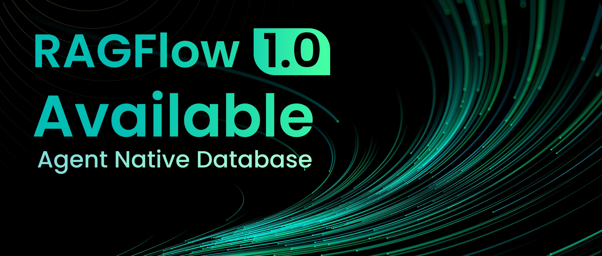
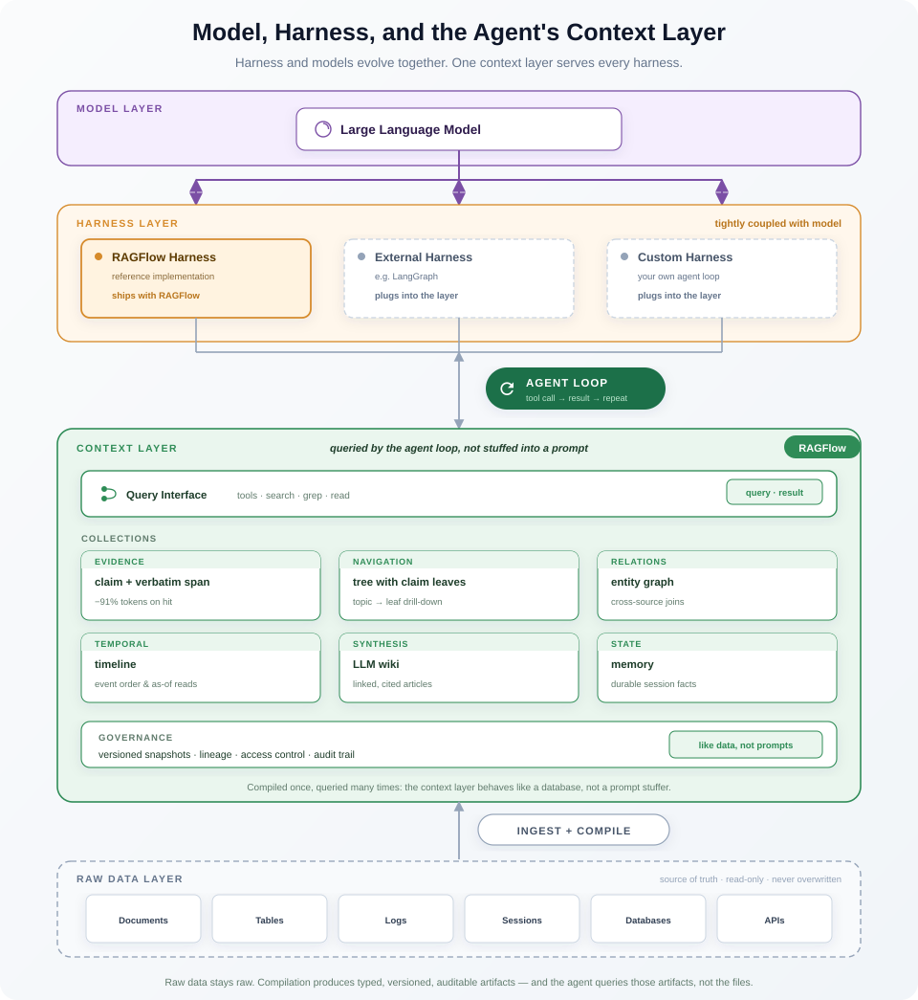
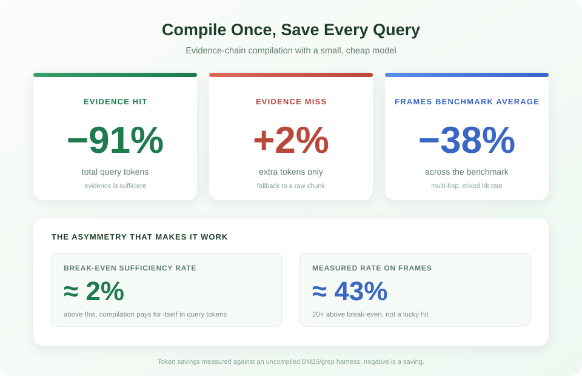
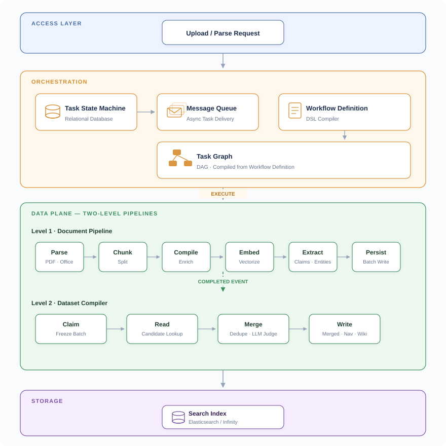
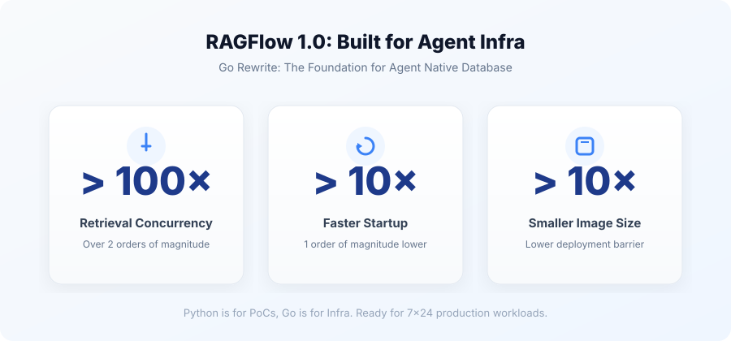
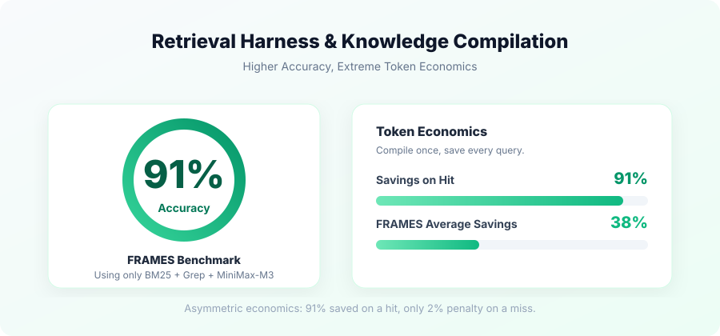

For the past two years, almost every enterprise has been using RAG to solve the challenge of grounding large language models (LLMs) in real-world applications.

Split documents into chunks, generate embeddings, run similarity search, and feed the results into a prompt. Simple, straightforward, and seemingly foolproof.

But anyone who has actually brought this into a production environment knows: **RAG is far from good enough.**

It struggles to retrieve exact dates reliably, often misses information related to vaguely defined concepts, and returns mostly irrelevant results when searching across multiple documents. So more techniques were added to the mix: GraphRAG, RAPTOR, and Contextual Retrieval. Architecture diagrams grew more elaborate and teams kept expanding, yet the gains didn't keep pace with the growing investment. The systems grew more complex without becoming much more reliable.

Meanwhile, another approach was gaining traction: an **Agent Harness** equipped with simple tools like Grep could already outperform carefully tuned RAG in many scenarios. But this approach has limits too: as data volumes grow, the Agent searches and retries repeatedly, driving up token consumption and response times.

**These approaches have all reached their limits.** The problem isn't that any one product falls short; it's that the entire paradigm calls for a different question:

At its core, is retrieval about "designing a stronger recall algorithm" or about "designing a system that can dynamically orchestrate and continuously supply context"?

This question has been answered over the past six months by different people, from different perspectives, and in different ways.

**Andrej Karpathy introduced the idea of "LLM Wiki"**, arguing that knowledge should be compiled once and continuously updated, rather than reconstructed for every query. This idea extends beyond personal knowledge management into enterprise RAG, directly challenging the long-standing practice of assembling snippets from scratch for every prompt.

**PwC's "Is Grep All You Need?"** equipped an Agent with both vector search and Grep, finding that Grep often achieved higher accuracy. But the real conclusion of the paper isn't that "exact matching alone is sufficient"—it's that **retrieval depends less on the tool itself than on the framework** that determines what enters the context and what the Agent does before using it **[1]**.

**Microsoft's AgenticRAG** breaks retrieval into three tools: SEARCH, FIND, and OPEN. Ablation studies show the biggest gain comes from "shifting from single-shot retrieval to Agentic tool use." In other words, the value comes from orchestration, not a stronger retriever.

**Industry voices have been even more direct.** VentureBeat noted, "The RAG-to-vector database pipeline is no longer sufficient; Agentic AI needs a different way to integrate context." Pinecone, a pioneer in the vector database space, launched Nexus in 2026—a next-generation knowledge engine built specifically for Agents. Its CEO put it even more bluntly at the launch: "RAG was built for human users; Nexus is built for agent users—their language is completely different, their expected responses are completely different, and the tasks assigned to agents are completely different from chatbots."

These voices come from different companies, papers, and products. They may not cite each other, but they point to the same conclusion:
**The center of gravity in retrieval is shifting from "recall algorithms" to "orchestration frameworks + context supply." The Search Harness handles retrieval, while Knowledge Compilation makes context more efficient to use.**

This is not just RAGFlow's view; it is an emerging industry consensus.

What RAGFlow 1.0 aims to do is not to propose this judgment, but to turn it into a product built for long-term operation: rewriting the foundation in Go, redesigning the internal architecture, and making knowledge compilation and high-quality context supply available as infrastructure that any Harness can call.

**Today, RAGFlow 1.0 is officially released.** This is not an ordinary version update, but the starting point of RAGFlow’s evolution from an end-to-end RAG engine into an **Agent Native Database**.

---

## I. Agent Native Database: Not a Buzzword, but a New Division of Labor

Starting from 1.0, RAGFlow is officially positioned as an **Agent Native Database**.

This positioning needs to be clearly defined; otherwise, it's just a marketing term. RAGFlow is not an end-to-end RAG engine or a retrieval backend that merely "feeds fragments to the model." It is a **Context Supply Layer** that an Agent Harness can access directly.

What does it supply? Raw text snippets, compiled evidence units, navigation structures, relational skeletons, timelines, Wikis, ontology assertions, and Memory facts—whatever the Harness needs, RAGFlow can provide it. The division of labor can be summarized in one sentence: **The Harness orchestrates, and RAGFlow supplies.** As shown below:

Why propose this positioning now? Because retrieval in the Agent era is no longer a single function call that "queries once, retrieves a few snippets, and passes them to the model." It is a process of "multi-turn orchestration + context governance." This process requires not just a stronger recall algorithm, but an independent layer capable of continuously supplying high-quality context, compressing Tokens, tracing evidence, and governing permissions and versions. **The supply layer must be an independent product, rather than being stuffed inside a RAG engine or vector database.**

Knowledge Compilation is the core capability of this supply layer. It shifts the "understanding" work from query-time to index-time: **compile once, benefit many times.**

Take the evidence chain as an example: on a hit, a single query can save over **90%** of Tokens; on a miss, it only costs about **2%**. On the complex multi-hop Benchmark FRAMES, the evidence chain saves an average of **30–40%** of Tokens. This asymmetry—"extremely high returns on hits, extremely low costs on misses"—provides the economic rationale for making the supply layer an independent product. It allows the Agent to avoid starting from scratch every time and avoids paying uncontrollable Token costs for exploration.

This asymmetry also implies a very low break-even point: as long as the evidence chain hit rate exceeds about **2%**, the compilation cost can be covered by query savings. On FRAMES, using the free model GLM-4-Flash for compilation, the measured hit rate approached **43%** **[2]**. In other words, knowledge compilation is not a "gamble on hits"; it is a profitable proposition for the vast majority of corpora.

Beyond evidence chains, knowledge compilation also includes graph-based exploration, timelines, LLM Wikis, and other formats; Ontology and Memory templates are on the way. Evidence-chain navigation trees, graphs, LLM Wikis, and timelines are already available in 1.0.

Putting these formats together, the essence of the Agent Native Database becomes clear: **It is not another kind of database, but a Context Supply Layer.** There is no query language, and it does not replace any storage. It compiles raw data into context artifacts that the Agent can directly query—claims with verbatim evidence, entity relations, timelines, ontology labels—typed, versioned, and governable—and then the Harness decides what to read for a given question. The compiled artifacts are data; the Harness decides what enters the window; and tools are the only path.

A system designed to produce and deliver this context, rather than to sort and return chunks, is an Agent Native Database.

RAGFlow 1.0's division of labor is one sentence: **The Harness orchestrates, RAGFlow supplies.** Only when the supply layer becomes an independent product can the Agent focus on orchestration and reasoning, and can enterprises govern context as data rather than assembling it into Prompts.

---

## II. Architectural Redesign: Built for "Long-Running" Operations

Two things are particularly problematic for enterprise data governance: a dangling state where a task exists without a corresponding record, and failures that leave behind partial documents or ghost evidence.

RAGFlow 1.0 redesigned the Ingestion Pipeline and retrieval-side architecture. The goal is not to add features, but to make the system stable, scalable, and auditable under real production loads, supporting enterprise-grade data governance workflows. It re-implements the Ingestion Pipeline as a **two-level pipeline + two orchestration axes.**

**Two-level pipeline**: The document-level pipeline handles parsing, chunking, compilation, vectorization, extraction, and persistence for a single document; the dataset-level compilation handles cross-document merging of Wikis, graph structures, navigation, and other compiled artifacts. The former handles "one document," while the latter handles "relationships between a batch of documents."

**Two orchestration axes**: All workflows—whether Ingestion Pipeline templates or Agent workflows—are driven by unified process definitions, compiled into DAG task graphs for execution; task scheduling goes through a database state machine + message queue, rather than being hardcoded.

The overall Ingestion architecture is as follows:

Design trade-off in one sentence: **Processes are defined by configuration, not hardcoded; failure recovery relies on task redelivery plus result caching.**

### 1. Orchestratable and Fault-Tolerant Incremental Processing DAG

From ingestion to persistence, each layer of the DAG corresponding to every Ingestion Pipeline has clear failure boundaries and recovery strategies:

*   **Ingestion**: Record the state before dispatching. If dispatching fails, roll back the record. There will never be a dangling state where "a task is running, but no record exists in the system."
*   **Delivery**: If a task is redelivered due to network issues, the system only extends the lease and never resets the already parsed progress. The database state is the final source of truth.
*   **Execution**: State transitions are absolutely safe. If a crash occurs, it is caught, marked as failed, and the task is returned to the queue. The system clearly distinguishes between "system downtime," "user cancellation," "parsing failure," and "successfully completed"—no mixed signals.
*   **Persistence**: Batch writes. If a batch ultimately fails after retries, the system automatically deletes the partially written data. You will never search and find a "half-document."
*   **Compilation artifacts**: During re-parsing, the previous generation of knowledge artifacts remains available and does not impact business operations. Old ones are only replaced after the new ones are fully generated. The same applies to Wiki generation: it is temporarily staged, and a failure does not affect the original knowledge base.
*   **Cross-document merging**: The true progress of a task is determined by the database; the message queue only sends notifications. Processing happens in fixed batches; a task is only marked complete when the entire batch succeeds. If it fails midway, the task remains in the queue for the next retry. When overwriting or deleting existing data, a data lock must be acquired and operation permissions verified to prevent data corruption from concurrent modifications.

Clear design trade-off: **No checkpoint-based resumption within a workflow.** Recovery relies on "task-level redelivery + component-level result caching," so a failure degrades only to the "incremental cost of rerunning a task once." This avoids the high resource overhead and maintenance burden of a complex checkpoint-based resumption mechanism.

### 2. Multi-Version Governance

Enterprise scenarios require version governance. RAGFlow 1.0 builds it into the system along two tracks: one manages execution orchestration, the other manages knowledge provenance.

**Pipeline versions determine "which graph this document runs on."** Each manual save generates an immutable version; binding is document-level—the dataset saves the version used, and uploads or new documents inherit it. Subsequent dataset version changes do not write back to already uploaded documents. Therefore, multiple versions coexisting in a dataset is the norm in enterprise scenarios, not an anomaly. At runtime, prioritize the bound version; only if there is no binding, use the latest version; if the bound version fails, the task fails and prompts for reselection, rather than silently using the wrong version. The run ledger records "which run number, which process it ran," making each execution traceable.

**Compilation version governs "which template produced this knowledge."** Template drafts can be modified; only published versions take effect, and snapshots are no longer updated once written. Retiring does not delete snapshots; extracted assertions can always explain "which version of the model said it." Every row of the artifact carries a version stamp, and diagnostics can directly answer "is this evidence left over from an old version."

The two lines have clear responsibilities: Pipeline versions make execution rollbackable, and compilation versions make knowledge traceable. **Only when enterprises have the confidence to roll out changes gradually, roll back when needed, and conduct audits will they be willing to entrust their core data to a system for the long term.** This is the foundation of trust for the Agent Native Database.

### 3. End-to-End Performance Optimization from Parsing to Persistence

High performance is not achieved by tuning a single component, but through systematic optimization from ingestion to persistence.

**Faster parsing.** DeepDoc has been completely rewritten, fully retaining PDF and Office compatibility while achieving a significant speedup compared to previous versions. In pure text parsing scenarios that do not involve OCR, the speed reaches an order of magnitude higher than previous versions.

**Layered concurrency.** To process massive documents faster, RAGFlow divides concurrency into three layers:

*   **Task-level concurrency**: Worker pools default to the number of CPU cores, naturally deduplicating tasks for the same document without wasting compute.
*   **Document-internal concurrency**: Extraction thread pools (e.g., tagging, summarization) are shared globally to prevent a single massive document from draining system resources; vectorization is strictly batched by model batch size to significantly reduce network request overhead.
*   **Dataset-level merging**: This is the most unique layer. Compilation across different knowledge bases processes fully in parallel without interference; however, processing for the same knowledge base must be serialized by claim records. This seemingly sacrifices concurrency speed, but it is a necessary correctness constraint—concurrent merges into the same database would cause data overwrites and conflicts.

The first two layers squeeze out maximum performance, while the last ensures absolute data accuracy.

**Batching.** Index writes are batched, with a refresh only after the last batch, reducing the number of refreshes from N to 1; deduplication and merging use a single model round-trip instead of pairwise comparisons; multiple candidates from the same similarity hit are grouped before being merged and written.

**Caching.** Chunk cache uses "type + model + chunk + result-affecting configuration" as the key, caching model outputs and vectorization results; reruns make zero model calls for the same chunk; media cache saves images and visual parsing results, only cleaning up after successful persistence, retaining failures for retry.

**Avoiding full scans.** Dataset compilation only reads artifacts of the current document, then uses similarity retrieval to find candidates, never loading the entire knowledge base; Wiki calculates contribution differences first, returning early if there are no changes.

**Rate limiting and backoff.** Rate-limit cooldowns are shared across workers using the same provider instance; when one worker is rate-limited, other workers from the same provider back off together, while other providers are unaffected; backoff covers about two and a half rate-limit windows and respects the wait time returned by the server; extremely long inputs use a stepwise reduction strategy, and if still failing, are isolated and retried one by one, avoiding one bad input dragging down the entire document.

The performance ceiling of this design is determined by two real constraints: "serialization within the same knowledge base" and "external model quota." The framework layer's responsibility is to parallelize, batch, and cache all other stages, and to limit the cost of failures to "the incremental cost of rerunning a task once."

### 4. From Ingestion to Retrieval: After Compilation Artifacts are Persisted

The Compile stage in the document-level pipeline is responsible for compiling raw documents into retrievable knowledge artifacts. This stage has three engineering requirements: **concurrency, idempotency, and detachability**. Document compilation is a highly parallel task, and 1.0 supports concurrent compilation and idempotent rebuilding—preferring to recompute entirely rather than leaving a half-new, half-old structure. Each compilation artifact carries lineage; when a document is deleted, related contributions are precisely removed, leaving no ghost evidence in the index.

After compilation artifacts are persisted, how does the retrieval side consume them? The retrieval-side architecture of 1.0 revolves around four design principles.

**Tool layer: Parallel invocation, errors become observations, stable contracts.** Multiple retrieval actions in the same round can be executed in parallel; tool errors do not interrupt the entire round but become a result the model can understand; tools always return candidates, not conclusions. Stable tool contracts mean upper-layer Harnesses can be replaced or combined without worrying about underlying behavioral drift.

**Harness layer: Stateful, recoverable, attributable.** A session is an event log; failed rounds are rolled back, and "calls made, no results" debris is not carried into the next round; cross-round persistence only retains the final answer of each round, not the evidence-gathering trace, so long conversation costs do not grow linearly with rounds; each round's cost is attributed by stage—evidence gathering, answering directly from evidence, and summarization. When an answer is wrong, we can distinguish between "didn't find it" and "found it but didn't use it."

**Channel isolation: Strict separation of raw and derived content.** Content retrieval for model reading always excludes compilation artifacts; compilation structures enter the context only through compilation tools. Derived knowledge does not impersonate raw text, and raw text is not drowned out by structure. This is a prerequisite for collaboration between the supply layer and the Harness, as well as for enterprise auditing.

**Auditability: Every piece of evidence is traceable, every round's cost is attributable.** Every piece of evidence that actually enters the model has a record: which words hit, whether it was truncated, how large the original text is. This is not log redundancy; it's a basic requirement for infrastructure products—when something goes wrong, we need to be able to pinpoint it.

Behind these designs is the same principle: **The evidence entering the context must be the smallest sufficient set for this moment.** Knowledge Compilation is responsible for compressing, structuring, and making context traceable; the Harness is responsible for judging whether it's enough, whether to send, and whether to read. The specific mechanisms have been elaborated in our paper, "Context as Infrastructure: Knowledge Compilation for Retrieval in Agentic Systems with Harnesses" **[2]**; we will not repeat them here. The question RAGFlow 1.0 addresses is how to turn these principles into engineering guarantees.

**Summary: 1.0's stability and performance come from architecture, not tuning.** Orchestratable, fault-tolerant, multi-version governable, and available to the retrieval layer—these four points together form the engineering foundation of the Agent Native Database.

---

## III. Why We Rewrote RAGFlow 1.0 in Go

The foundation of the architectural redesign is another, more fundamental change: RAGFlow 1.0 is completely rewritten in Go, replacing the previous Python version. Here is a harsh fact: **Infra built with Python struggles to reach production.**

This is not an attempt to "switch languages for performance," but an inevitable choice after the product positioning changed. When RAGFlow is no longer just a RAG engine, but a context supply layer that the Agent Harness depends on long-term, the demands on the foundation change: it needs to run 7×24, concurrently compile massive documents, manage long session states, and maintain clear boundaries during failures. The cost of dynamic languages in these scenarios will be exposed bit by bit: type errors blow up at runtime, concurrency models are constrained by the interpreter and the GIL, and long-running resource usage and fault isolation are almost unpredictable.

Go brings not just speed, but three things:

**First, stability.** Static typing and compile-time checks intercept a large number of errors at the build stage; clear error handling paths make failure boundaries clear and searchable; single-binary delivery makes deployment and rollback controllable.

**Second, concurrency model.** When the initiator of retrieval shifts from "single queries by human users" to "multi-turn, high-frequency calls by Agent Harnesses," the RAG paradigm upgrades to the Retrieval Harness, causing concurrent request volumes to experience explosive, order-of-magnitude growth. After the Go rewrite in RAGFlow 1.0, retrieval concurrency has improved by more than two orders of magnitude. Under the constraints of Python's GIL, meeting such stringent requirements would be completely impossible. The concurrency of knowledge compilation, parallel invocations at the tool layer, and long-session state management of the Harness all have unified semantics under goroutines and channels. Timeouts, cancellation, and error propagation no longer rely on third-party libraries acting independently.

**Third, long-running operation.** GC behavior, memory usage, and fault isolation are predictable in production environments. A system that needs to run 7×24 cannot pin its stability on the hope that "this time it won't go wrong."

In one sentence: **Python is fine for PoCs, but not for serious Infra.** RAGFlow 1.0 chose Go because it is preparing to stay in the production environment for the long term.

Language is the foundation, architecture is the upper layer. Together they form the engineering foundation of the Agent Native Database.

---

## IV. What Developers Get in RAGFlow 1.0: Capability List and Migration Guide

RAGFlow 1.0 is now open to developers. Here are the capabilities and migration points you can use directly in this version.

**Deployment and operation.** 1.0 provides a Go-version installation and deployment method, supporting containerized deployment and standalone operation; the container image size is reduced by nearly an order of magnitude compared to previous versions, system startup latency is reduced by an order of magnitude, and an official ARM image is also provided, significantly lowering the deployment barrier.

**Knowledge Compilation template system.** 1.0 comes with built-in templates for tree navigation (including evidence chain nodes), graph exploration, timelines, LLM Wikis, etc., and provides template configuration capabilities: what to extract, which fields to output, which constraints to follow, and in what format to present—all customizable by domain without modifying engine code. Enterprises can finally distill domain knowledge into templates instead of hardcoding domain logic into the system.

**Retrieval Harness system.** How capable is the Retrieval Harness in version 1.0? On the demanding FRAMES Benchmark (which is more challenging than classic multi-hop datasets like HotpotQA, where each question requires synthesizing 3–4 articles from over 2,200 to derive the final answer), it achieved an accuracy of 0.91 using only MiniMax-M3. The 1.0 Harness provides configurable tool sets, step limits, time budgets, parallel strategies, and evidence gate behaviors. The default behavior is oriented towards general scenarios; enterprises can adjust tool exposure strategies and gate strategies based on corpus characteristics. 1.0 also provides a decision model as an optional component for the evidence gate: when there are no compilation artifacts, it can significantly reduce Token consumption; when compilation artifacts are present, it can significantly accelerate Agent response speed. In other words, whether or not the enterprise has completed Knowledge Compilation, 1.0 can bring measurable cost or latency benefits.

**Migration from Python version.** The 1.0 API is compatible with the Python version, allowing seamless upgrade from 0.27.x, and the accompanying data model migration is automatically completed when the container starts.

---

## V. Ecosystem and Roadmap

RAGFlow 1.0 is open source, with the compilation layer, tool layer, and Harness continuously open. The roadmap ahead focuses on four directions:

**Expanding Knowledge Compilation input formats.** In addition to documents, we will cover more enterprise data formats—tables, logs, sessions, databases, API responses—so the supply layer can connect to a broader range of knowledge sources. The value of the supply layer depends on how many types of context it can supply; the richer the input formats, the more complete the knowledge the Harness can call upon.

**Deepening integration with external Harness frameworks.** We will provide more stable tool interfaces, clearer evidence formats, and more complete integration examples, so external Harnesses can consume RAGFlow's supply capabilities at a lower cost. RAGFlow does not aim to be the only Harness, but a supply layer that any Harness can call.

**Promoting reusable engineering standards.** Evidence chains, ontology templates, and Memory templates should not be proprietary architectures, but reusable engineering standards—with clear formats, lineage rules, and audit requirements, allowing different systems to exchange compilation artifacts. This is a key step for the supply layer to evolve from "a product" to "infrastructure."

**Co-building community and domain templates.** The template system of Knowledge Compilation requires domain knowledge: legal, medical, financial, manufacturing—each domain has its own entity types, relational constraints, and evidence requirements. RAGFlow will continue to improve built-in templates and welcomes community contributions of domain templates.

We invite developers to participate: try 1.0, file issues, contribute templates, and participate in benchmarks. The maturity of infrastructure products relies on real-world feedback.

---

## VI. Conclusion: 1.0 is a Starting Point, Not the End

The crossroads facing RAG is not about "whether to retrieve," but about "how retrieval is orchestrated and how context is supplied."

RAGFlow 1.0's approach is to use Go to build a solid infrastructure foundation and establish the supply layer as an independent product through the Agent Native Database. **The Search Harness is responsible for finding, while Knowledge Compilation is responsible for making context more efficient to use. Compile once, benefit many times**—this is the starting point of context infrastructure in the Agentic era.

1.0 is not the end. It is a foundation rewrite, a positioning upgrade, and an engineering answer to "context as infrastructure." Moving forward, RAGFlow will continue to expand compilation formats, deepen Harness integration, and promote engineering standards, making this supply layer infrastructure designed for long-term operation in the Agent era.

**The era of RAG is not over; it just needs a rewrite. RAGFlow 1.0 is the beginning of that rewrite.**

We invite you to follow RAGFlow and give it a try.

**References**

1. Is Grep All You Need? How Agent Harnesses Reshape Agentic Search. arXiv:2605.15184

2. Context as Infrastructure: Knowledge Compilation for Retrieval in Agentic Systems with Harnesses. arXiv:2610.41172