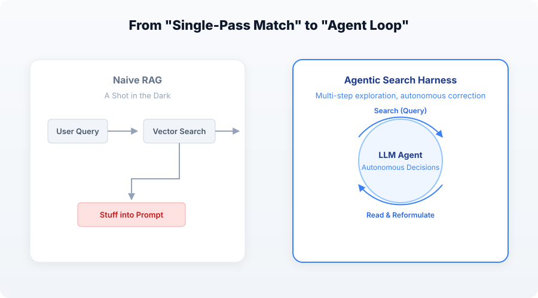
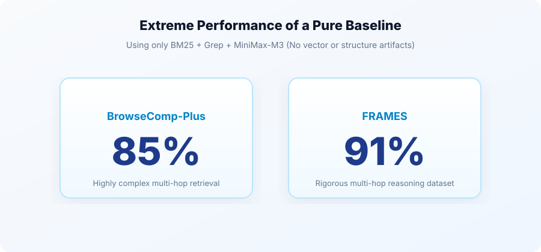

**Subtitle: A Paper Walkthrough — From the Failure of Structured Artifacts to the Economics of Evidence Chains**

If you're still building systems with a naive RAG pipeline—chunking documents, generating embeddings, calculating similarity scores, and feeding the retrieved chunks into a prompt—you've probably encountered a frustrating problem: no matter how good an embedding model you switch to, how finely you tune your chunking strategy, or how advanced a reranker you add, the system still fails to retrieve the right evidence for complex questions.

Why is that? Because naive RAG has a fundamental architectural flaw: **it tries to solve a problem that inherently requires multi-step exploration with a single retrieval step.**

In real-world enterprise settings, users often ask questions with ambiguous prerequisites or questions that require piecing together facts from multiple documents. The biggest problem with one-shot vector matching is that it amounts to **taking a shot in the dark**: if the first retrieval pass misses the chunk containing the answer, even the most capable generation model cannot recover it. Adding reranking or hybrid search still means optimizing within a single-query approach.

The biggest drawback is that this approach gives up the LLM’s role as the **reasoning hub** for the task as a whole. Relying on a static retriever to match words or vectors effectively reduces the LLM to a machine that can only interpret text at face value: good at local optimization, but weak at reasoning across the whole task. Once multi-step exploration is required, accuracy inevitably breaks down. That is why **agentic search is the only way to ensure accuracy in complex production scenarios.**

Given that LLMs already have strong reasoning and instruction-following capabilities, why force them to gamble on a single match? Instead, hand them the steering wheel and let them search for themselves. The model first writes a lexical query (**Query**), examines the results (**Read**), and, if it finds that it is heading in the wrong direction, changes the query or narrows its scope (**Reformulate**). It repeats this process until it has gathered enough evidence to answer (**Stop**).

This autonomous **"Search → Read → Reformulate"** loop frees RAG from a rigid pipeline. Once the agent controls the loop itself, something interesting happens: **the underlying retrieval algorithm seems to matter much less.**

An agent equipped with nothing more than BM25 and Grep can often outperform a finely tuned vector database in accuracy. The reason is straightforward: the agent itself handles semantic understanding through the iterative loop. Grep only needs to provide a faithful, semantically unbiased **primitive for locating text**.

In this setting, **search has become a Harness problem rather than an indexing-algorithm problem.** The Harness orchestrates the loop, enforces constraints, and decides what enters the context. The retrieval layer simply needs to be a reliable tool for locating information. But Harness design is still an emerging area, and the industry is still figuring out which architectures can truly bring out the best in agents.

That raises an intuitive hypothesis: if the Harness is already so powerful, would giving it more sophisticated **structured tools**—a RAPTOR summary tree, a PageIndex table of contents, or a GraphRAG knowledge graph—make the agent even more capable and its retrieval more accurate?

In our latest paper submitted to arXiv, ***“Context as Infrastructure: Knowledge Compilation for Retrieval in Agentic Systems with Harnesses,”*** we used rigorous ablation studies to disprove that intuition.

This is a walkthrough of the paper, not a coding tutorial. We will unpack its two central findings: **First, why does adding structure to a Harness fail to improve accuracy? Second, if it does not improve accuracy, why can knowledge compilation still be a reliably profitable investment?**

---

### I. Why Are BM25 + Grep Enough?

Before discussing what happens when we add more components, we need to understand the baseline.

The paper uses a deliberately simple baseline: **BM25 + Grep only, with no vector index and no compiled index, and MiniMax M3 as the answer-generation model.**

Even with this extremely **basic** setup, the Harness achieved **85% accuracy** on the highly complex multi-hop BrowseComp-Plus dataset, placing among the top entries on the leaderboard, and **91% accuracy** on the multi-hop FRAMES dataset, ranking second among the publicly available results we could find.

This demonstrates a key point: **In a Harness architecture, vector search is no longer a default requirement.** Vector search was originally designed to address the **vocabulary mismatch** that occurs when people enter short queries. Agents are different: through repeated searches, query reformulation, and additional constraints (OpenAI’s analysis, for example, found that agents are particularly fond of exact-match queries in quotation marks), they can bridge that vocabulary gap themselves. BM25 may be weaker in a single retrieval pass, but it becomes extremely effective inside an agent loop because it provides precise, interpretable anchors; the model handles the remaining semantic reasoning.

**So does that mean vector search is useless?**

Not at all. Vector search has not disappeared; it has simply moved into the role where it belongs.

For tasks that primarily involve **finding the original text**, BM25 + Grep is good enough. But vector search still matters where semantic recall is genuinely indispensable. For example, in the knowledge compilation framework proposed in the paper, suppose you need to retrieve extracted **claims**. Because the wording of a user’s question can differ substantially from the wording of a claim, applying **hybrid search (BM25 + vector search)** directly to those claims makes good sense. The top-ranked entries on the BrowseComp-Plus leaderboard also use **ColBERT-based MultiVector** approaches. RAGFlow does not currently use these approaches, mainly because MultiVector substantially increases storage and memory overhead. More effective compression methods are still needed, but these approaches remain valuable options for the future.

---

### II. Why Did Structured Artifacts Fail Across the Board?

With such a strong baseline, we added several mainstream **structured approaches** to the same Harness, one by one, to see whether they could deliver any further gains in retrieval accuracy:

1.  **RAPTOR-style summary trees**: No statistically significant improvement in accuracy.
2.  **LLM Wiki**: No meaningful improvement in accuracy.
3.  **Entity-Relation Graph (GraphRAG style)**: No meaningful improvement in accuracy.
4.  **PageIndex-style outlines**: No improvement; performance actually deteriorated at scale.

Why does this happen? We need to examine each technique separately.

Start with RAPTOR. It builds a semantic tree by hierarchically clustering embeddings of the original chunks. In naive RAG, this can be valuable for recalling content that spans chunks. But in a well-designed Harness, BM25 + Grep is already an on-demand, dynamic mechanism for locating content across chunks; a static semantic tree becomes redundant.

PageIndex is a common technique in long-context solutions that claim to replace RAG: extract a document’s table of contents and let the LLM choose which documents and sections to read. In our tests, however, it showed severe negative degradation. The reason is critical: it abandons Retrieval’s high-precision localization and instead hands short, information-poor outline text to the LLM to guess blindly. This drives up token consumption, slows responses, and, because information is missing, makes incorrect routing more likely. Any approach to LLM context limits that discards retrieval is inherently unreliable.

What about LLM Wiki and knowledge graphs (GraphRAG)? The fact that they did not score highly on the benchmark does not mean these techniques are unnecessary. In fact, knowledge graphs and enriched ontology semantics have long been used extensively in real business settings; how they can prove themselves on a pure retrieval benchmark still needs further exploration. LLM Wiki’s value is likewise demonstrated in business contexts: it excels at synthesized reading, not recall of isolated facts.

More importantly, the consumers of these compiled artifacts are not only Harness systems but also people. Humans and Agents consume knowledge in fundamentally different ways. Humans need a Wiki to quickly build macro-level understanding and graphs to clarify complex business relationships. We should therefore not dismiss these artifacts as meaningless; it is just that their broader commercial value cannot be reflected in current benchmarks.

---

### III. The Central Finding: The Token Economics of Knowledge Compilation

If knowledge compilation does not improve accuracy, what is it for?

The paper shifts the focus from **accuracy** to **cost** and identifies a mechanism capable of delivering substantial returns: **knowledge compilation with claim–evidence pairs as leaf nodes.**

Here, the tree is not used as a retriever but as an organizing structure: it provides the chapter hierarchy, while its evidence-chain leaf nodes provide compression through **atomic claims paired with verbatim quotations from the source text**. Before the agent Harness reads an original chunk, it first reads the claim and its evidence. If it determines that the evidence matches the question, it answers directly from that evidence without reading the chunk.

The measured results reveal a striking **asymmetry in the economics**:
*   **On a hit**: Token use for a single question falls by **91%**.
*   **On a miss**: The agent still reads the original chunk, with token consumption increasing by only about **2%**.
*   **On average**: Token consumption on FRAMES falls by **38%**.

These figures lead to a conclusion with significant commercial value:
Assume the compilation cost is \(C\) spread across \(N\) queries. As long as the hit rate exceeds **2%** (the break-even point), the compilation cost is covered by the query savings. In real-world complex multi-hop scenarios, we used an extremely low-cost model (GLM-4-Flash) for evidence extraction and achieved a measured hit rate of nearly **43%**.

**Once the hit rate exceeds 2%, the investment pays for itself and delivers a positive return.** That is the economic foundation of knowledge compilation. Its job is not to make retrieval **more accurate**, but to make it **less expensive**.

---

### IV. What Does It Take to Make These Economics Work in Practice?

If the goal is to **save tokens**, the guiding principle for system architecture becomes: **only the smallest sufficient set of evidence should enter the context at any given moment.**

The paper examines the engineering disciplines a Harness needs to follow to achieve that goal:

1.  **Evidence Gate**: This is what closes the loop on token compression. Rather than reranking, it asks: **“Does this batch of evidence need to be sent to the LLM right now?”** If the evidence is sufficient, it is allowed through; otherwise, the entire block is discarded—not added to the system prompt and not assigned citation numbers.  **Deciding *not* to send evidence saves more tokens than sending *higher-quality* evidence.** The Evidence Gate is also where introducing a Jev-style decision model can provide real value. 
2.  **Deciding Not to Read**: Before reading a chunk in depth, use Claim/Evidence to judge whether there is already enough information to answer. If there is, skip the chunk.
3.  **Mechanical Citation Assignment**: Assign citation numbers as soon as evidence is delivered to the model, avoiding repeated reasoning over citations and reducing hallucinations and the cost of retries.
4.  **Channel Isolation**: Keep original source text strictly separate from derived content so that every evidence-chain hit remains traceable and auditable.

**Engineering Foundations: How Does Grep Actually Work?**

With large document datasets, if the retrieval layer relies on Grep for high-frequency regex matching and the Harness issues multiple queries per second, scanning the entire corpus on every query would inevitably cripple system performance. How is this avoided?

Certainly not by scanning the entire corpus on every query. In RAGFlow 1.0, Grep is implemented at the search-engine level as a candidate-generation mechanism. On both supported retrieval engines, it does not fall back to a naive full scan::

*   **On Elasticsearch**: RAGFlow uses Elasticsearch’s `regexp` query to push regular-expression matching down into Lucene. The regex can therefore participate directly in pruning candidates through the inverted index; only candidate documents that match proceed to exact verification by the regex engine.
*   **On Infinity**: RAGFlow uses Infinity’s built-in **sparse n-gram analyzer**. A sparse n-gram index first narrows the search to a set of potentially matching candidates, and the full regular expression then verifies those candidates. This prevents even frequent regex queries from overwhelming the system and slowing response times.

**That is the engineering foundation that makes BM25 + Grep an “all you need” solution.**

---

### V. Conclusion: From “More Powerful” to “More Efficient”

Using rigorous data, this paper challenges a widespread industry assumption: **do not expect more complex structures to improve accuracy when the underlying retrieval is already accurate enough under a powerful Harness.**

It offers a new way to look at the problem: in the agentic era, **search is a Harness problem, while knowledge compilation is an economics problem.**

The best approach to knowledge compilation is not to build a perfect tree, but to extract **evidence chains** that can be traced back to the original source text. These chains can cut token consumption by more than half without sacrificing accuracy. That is what makes **“Context as Infrastructure”** viable in both engineering and business terms.

If you want to explore the paper’s token cost model, the details of its gate design, or the full ablation results across different evaluation datasets, we strongly recommend reading the paper itself.

**Paper Link**: [Context as Infrastructure: Knowledge Compilation for Retrieval in Agentic Systems with Harnesses. arXiv:2610.41172](https://arxiv.org/abs/2610.41172)