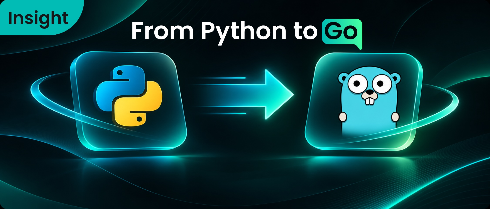

Over the past two years, the Python version of RAGFlow has helped a large number of enterprises get complex RAG workloads running quickly, thanks to its rapid iteration and flexibility, and has become one of the most popular open-source RAG engines. Python’s advantages in the PoC phase and in ecosystem validation are irreplaceable.

But as the system was pushed into more and more enterprise production environments and began evolving toward an Agent Native Database, we hit a new bottleneck: when the system has to take over enterprise data governance 24/7, process tens of thousands of documents concurrently, and maintain extremely strict stability, the original foundation began to fall short.

In RAGFlow 1.0, we made a difficult but firm decision: rewrite the entire foundation from scratch in Go, a statically compiled language.

## I. Why Rewrite the 1.0 Foundation in Go?

Once RAGFlow is no longer just a retrieval backend but the context supply layer that Agent Harnesses depend on long-term, its engineering constraints on the foundation change.

### 1. Why Abandon Python?

Python got us here quickly, but when the system has to run for long periods, its costs are magnified:

- **From rapid experimentation to long-running operation**: RAGFlow is a typical I/O-intensive system. Constrained by the GIL, squeezing multi-core performance often requires complex async or cross-process mechanisms. When the system must manage both massive document concurrency and long-lived session state, maintenance costs rise exponentially.
- **From dynamic flexibility to clear boundaries**: the data flowing through the data pipeline is highly complex. The runtime flexibility of a dynamic language often means type errors can erupt at any time in production. If the compiler cannot check it, it becomes a time bomb at runtime.
- **Single-binary delivery**: no more complex virtual environments or dependency hell, making deployment and rollback much cleaner.

### 2. If We Were Rewriting, Why Go Rather Than Rust?

Rust is currently the favorite in AI infrastructure. When we decided to rewrite the foundation, we seriously evaluated Rust as well, but ultimately chose Go.

The reason is that RAGFlow’s core tasks sit at the orchestration layer: orchestrating the Ingestion Pipeline, orchestrating the Agent Harness, and handling task scheduling and state management. These tasks do not require the extreme memory footprint and zero runtime overhead pursued by low-level storage or retrieval engines—that is a concern for lower-level infrastructure such as Infinity, the retrieval engine RAGFlow depends on.

Go’s goroutines and channels are a natural fit for concurrent pipeline orchestration. More importantly, Go compiles extremely fast, and execution-time performance has little impact on the orchestration layer. While the Python version was still iterating quickly, we needed to “swap the wheels on a moving car.” Go’s very short compile-feedback cycle made this two-track development possible. In addition, when Google introduced the Agent Development Kit (ADK), it listed Go as one of its primary supported languages, which also confirms Go’s advantages for building high-concurrency Agent backends.

Rust for lower-level infrastructure, Go for the orchestration layer. That is the technology-selection logic behind RAGFlow 1.0.

## II. Architectural Reshaping: A Two-Level Pipeline and Two Orchestration Axes

RAGFlow’s data ingestion has never been “one function that runs to the end.” In 1.0, we abandoned the single-track flow and reshaped it into a “two-level pipeline + two orchestration axes.” This is not just about running faster; it is about giving the system the ability to handle complex business topologies.

**Two-level pipeline for both concurrency and isolation:**

- **Document-level pipeline**: handles parsing, segmentation, compilation, embedding, and extraction for a single document. This is a highly parallel, non-interfering process. The task-level worker pool expands by default according to the number of CPU cores, and tasks for the same document are naturally deduplicated. Whether an enterprise imports 100,000 PDFs in bulk or re-parses a single document, throughput can be maxed out.
- **Dataset-level compilation**: handles cross-document merging, including graph structure construction and incremental updates to the global Wiki. It deals with “relationships among a batch of documents.” Here, different datasets are processed in parallel, but the same knowledge base is serialized through claim records—a necessary correctness constraint to ensure data consistency during global merges.

**Two orchestration axes make the flow fully configurable:**

Starting with 1.0, all Ingestion Pipelines are defined by a unified DSL, including the built-in general document parsing templates that were popular in the Python version; they are compiled into DAG task graphs for execution.

- **DSL-driven**: the canvas version bound to a document is parsed and compiled. Components are instantiated from a factory by name, and parameters are divided into three levels: “DSL default parameters,” “dataset override parameters,” and “document-level override parameters.” This means enterprises can customize different parsing flows by business type (such as financial reports or legal contracts), and the same flow can be executed with different parameters for different documents without cross-contamination.
- **State-machine orchestration**: task scheduling uses a database state machine plus a message queue. State transitions use CAS operations to guarantee atomicity, completely eliminating the risk of dirty data from concurrent state overwrites.

**Flows are defined by configuration and can be customized on the canvas.** This is the prerequisite for the architecture to evolve over the long term and support complex enterprise business logic, and it is the underlying basis for “draw a flowchart and it runs.”

## III. End-to-End Performance Optimization

Go only gave us the tools. The real performance gains came from eliminating unnecessary calls, unnecessary waits, and unnecessary duplication one by one; single-point speedups were not the main source.

### 1. DeepDoc Reborn

The DeepDoc parser, popular in the Python era, has been completely rewritten. While fully preserving PDF layout analysis, table structure, and Office document compatibility, its parsing speed is more than an order of magnitude faster than the previous version; parsing results are passed downstream directly as in-memory structures. Data moves forward from the moment it enters the pipeline until it is written as an index, without stopping to wait for an external process. Parsing at the entry point is no longer the bottleneck for the entire ingestion pipeline.

### 2. Cache First: Prevent Duplicate Work from Happening at All

When the same content is processed again, the model should not compute it a second time. Extraction, tagging, summarization, metadata, and vectors for each segment are cached by “content, model, and configuration that affects results”; reruns, retries after failure, and re-parsing after changing only irrelevant parameters recompute only the affected parts. Intermediate parsing results are persisted to disk and reused across parsing, visual enhancement, and segmentation, so even parsing very large documents will not blow up memory. The cache is cleared only after the entire document is successfully persisted; on failure it is kept as is—so retries cost far less than the first run.

### 3. Batching and Rate Limiting: Minimize External Calls

Embedding requests are submitted in batches according to the model’s batch size; segments that hit the cache never enter the batch. Segment-level extraction runs in a fixed in-process concurrency pool, rather than creating a new pool for each document. When rate limiting occurs, a cooldown mechanism shared per service credential is triggered: when one task is rate-limited, calls under the same credential wait together, while other services are unaffected; for overlong inputs, the batch is shrunk first, and the suspicious item is then retried individually. Model judgments during compilation are likewise split into sub-batches by input window and run concurrently in the same compilation pool. As a result, rate limiting no longer means “the whole document fails and starts over”; it only causes local slowdown.

### 4. Writes and Merges: Don’t Pay for Unnecessary Waits

Segment identifiers are content-determined, and writes are overwrites rather than appends, so there is no need to read before writing and no duplication. During index writes, the system uses a “delayed visibility” strategy: except for the final batch, earlier batches do not wait for visibility; only the final batch waits for visibility uniformly. This ensures that data is immediately searchable when the task completes, while reducing expensive refresh overhead from multiple times to once. When a single write request is too large, the system automatically splits it into chunks for submission, avoiding rejection of the entire request by the storage side.

Cross-document merging likewise processes only the “potentially duplicate” portion: document-level compilation reads only the current document’s artifacts, and if the DSL has no compilation node, this step does not run at all; merging takes only the artifacts of the current batch of documents, first using vector nearest neighbors to find candidates for each claim, then grouping by candidate, with one model judgment per candidate group rather than pairwise comparison. Different datasets run in parallel, and the same dataset runs serially; merge volume is always “unique candidate pairs” and does not grow with the square of the total number of documents.

Individually, these choices look small; together, they determine whether the system “runs” or “collapses” when processing large numbers of documents.

## IV. Pipeline Fault Tolerance: Failure Is Allowed, but Half-Writes Are Not

In long-running pipelines, failure is normal: networks jitter, models get rate-limited, services restart. The core of fault-tolerant design is to make every failure converge to a deterministic state, not to pursue “never fail.” We treat this as a hard constraint: if any step is interrupted, the document must be either complete or empty; it must not stop halfway.

### 1. Error Classification and Retry Boundaries

When a model call fails, first determine the error type: network jitter, rate limiting, and server errors are worth retrying; authentication failures, invalid requests, nonexistent models, and blocked content are abandoned immediately. Each call has its own time budget and a retry cap with exponential backoff. Because the budget includes the time spent on retries, a stuck request is eventually forcibly interrupted and will never hold up the entire document.

### 2. Segment Isolation: Avoid “False Success”

Extraction proceeds segment by segment: if one segment times out, only that segment is abandoned; other segments continue to produce results, and segments that have already produced partial results are not invalidated. Only when all segments in this stage time out is the entire document marked as failed—that means the model is unavailable, not that a particular segment has a content problem. Non-timeout hard errors fail immediately, without carrying partial results forward. This rule prevents a single bad segment from dragging down the entire document, and prevents “the model is down” from being disguised as “the document has no content.”

### 3. Task-Level Redelivery, Not Checkpoint Resume

Recovery is task-level, not checkpoint-based. Tasks that lose execution ownership because of process kills, deployment restarts, or heartbeat interruptions—cases that were “not yet settled”—automatically return to the queue, with a cap on redelivery. Tasks already marked as failed are not automatically rerun—repeatedly retrying a bad document only consumes model capacity and time; whether to retry is a human decision. The same applies to runtime exceptions: record failure first, then return the message to the queue; the next delivery sees the terminal state and acknowledges it directly, so the same bad message is not redelivered repeatedly. Settlement recognizes only the terminal state in the database; whatever the execution function returns is merely a suggestion.

### 4. Idempotent Overwrites Make Reruns Absolutely Safe

Reruns are cheap because segment identifiers are content-determined: summaries, keywords, tags, and vectors that have already been computed hit the cache directly, and writes are overwrites rather than appends. When the entire document fails, rows written in this run are deleted; if the process crashes before deletion, a rerun overwrites with the same identifiers and, after success, reconciles and deletes compilation artifacts not produced in this run. The cache is cleared only after the whole document succeeds; on failure it is kept for the next attempt. Redelivery reuses the same run ID, so it remains one run for audit purposes and is not split into two.

## V. Multi-Version Governance: The Foundation of Enterprise Trust

Enterprise data governance fears two things most: “tasks without records,” and half-written documents and ghost evidence left behind after failure. Version governance answers exactly this question: when data keeps changing and pipelines keep being adjusted, can you still answer “what exactly did this execution use?”

### 1. Pipeline Versioning: Execution Orchestration

Each manual save creates a new version; once content is written, it is immutable. Changing the title, description, or alias only updates metadata and does not produce a version. Each pipeline retains at most 64 versions; once the limit is reached, saving fails directly with a prompt to clean up first—versions are never silently discarded. Binding is document-level: the dataset stores the version it uses, and uploaded or newly created documents inherit it; subsequent dataset version changes do not write back to already uploaded documents. So multiple versions coexisting in one dataset over the long term is normal, not an exception.

At runtime, the bound version is preferred; only when there is no binding is the most recently created version used. If the bound version’s owner is missing or the version has been deleted, saving is rejected and running tasks fail with a prompt to reselect; another version is never silently used. Each run leaves a ledger entry: which document, which dataset, and which run number; on success, the actual pipeline definition executed is written back, and redelivery does not create a new run ID. Before deleting a version, references are counted and a warning is issued, but it only warns and does not block; bindings to the deleted version enter the Missing state.

This line ensures that mistakenly changing a pipeline does not affect existing documents; to migrate, you explicitly rebind and re-parse.

### 2. Compilation Versioning: Knowledge Provenance

Configuration on a template is a draft and can be changed at any time; only publishing takes effect. Publishing writes an immutable snapshot and increments the version number; once written, the snapshot is never updated. Publishing has gates: blocking items are rejected outright, warning items require explicit confirmation; concurrent publishing uses the version number for conditional updates to avoid overwriting each other; retirement only changes status and does not delete the snapshot. Because compilation reads the snapshot, a half-edited draft cannot silently change the extraction basis for the corpus; and because publishing does not retroactively affect historical artifacts, a new version only affects subsequent compilation.

Every row of an artifact carries a version stamp; dataset merge rows take the highest version among contributors. The diagnostic API exposes this value and answers “which model version produced this piece of evidence.” Together with “how many datasets reference this model, and which ones,” it makes the impact visible before switching models.

The two lines have clear responsibilities: one makes execution explainable, the other makes knowledge traceable. Only then can enterprises confidently change pipelines, switch models, and conduct audits.

## Conclusion: The Confidence of Infrastructure Comes from the Weight of Its Foundation

For developers using RAGFlow, what you see may simply be faster parsing, a smoother UI, and a smaller image.

But for us, this Go rewrite is the necessary path for RAGFlow to become an Agent Native Database. Without the rigor of static typing, enterprise-grade version governance cannot be supported; without a native concurrency model, concurrent compilation of massive document volumes cannot be sustained; without reshaping the underlying architecture, the supply layer and orchestration layer cannot cooperate cleanly.

Language is the foundation; architecture is the layer above. Together they form the engineering basis of RAGFlow 1.0.