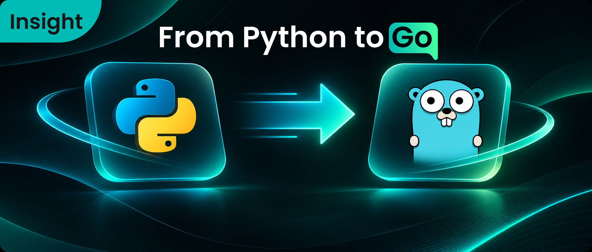
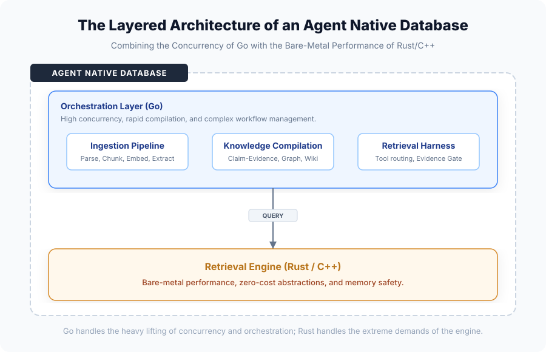

Over the past two years, the Python version of RAGFlow, with its extremely rapid iteration and remarkable flexibility, has helped numerous enterprises quickly get complex RAG applications up and running, becoming one of the most popular open-source RAG engines. Python's advantages in the PoC stage and ecosystem validation are irreplaceable.

But as the system was deployed in more and more enterprise production environments and began evolving toward an Agent Native Database, we encountered a new bottleneck: **when the system needed to take on enterprise-grade data governance 24/7, process tens of thousands of documents concurrently, and maintain extremely stringent stability, the original foundation began to struggle.**

In RAGFlow 1.0, we made a difficult but firm decision: **to rewrite the entire foundation from scratch in Go, a statically compiled language.**

## I. Why Rewrite 1.0 in Go?

When RAGFlow is no longer merely a “retrieval backend” but is intended to become the context supply layer that the Agent Harness relies on over the long term, the engineering constraints on its foundation change.

### 1. Why Move Away from Python?

Although Python enabled us to get where we are today quickly, when a system needs to “run continuously,” its costs become greatly magnified:

1. **From “rapid trial and error” to “long-term operation”:** RAGFlow is a typical I/O-intensive system. Constrained by the GIL, we often need complex asynchronous or cross-process mechanisms to squeeze performance out of multiple CPU cores. When the system must simultaneously manage massive document concurrency and long-running conversation states, maintenance costs rise exponentially.
2. **From “dynamic flexibility” to “clear boundaries”:** The data flowing through the pipeline is extremely complex. The runtime flexibility of dynamic languages often means that type errors can erupt at any moment in production. What cannot be checked at compile time becomes a ticking time bomb at runtime.
3. **Single-binary delivery:** Say goodbye to complex virtual environments and dependency hell, making deployment and rollback exceptionally straightforward.

### 2. If We Were Rewriting It, Why Go Rather Than Rust?

Rust is currently the “rising star” of AI infrastructure. When deciding to rewrite the foundation, we also seriously evaluated Rust, but ultimately chose Go.

The reason is that **RAGFlow's core tasks lie in the orchestration layer**: orchestrating the Ingestion Pipeline, orchestrating the Agent Harness, and handling task scheduling and state management. These tasks do not need to pursue the ultimate in memory efficiency and zero runtime overhead as underlying storage or retrieval engines do—that is a concern for lower-level infrastructure, such as Infinity, the retrieval engine on which RAGFlow depends.

Go's goroutines and channels are naturally suited to concurrent Pipeline orchestration. More importantly, **Go compiles extremely quickly, and runtime performance has little impact on the orchestration layer.** While the Python version was still iterating rapidly, we needed to “change the wheels on a moving car.” Go's extremely short compilation feedback cycle made this dual-track effort possible. In addition, Google listed Go as one of the primary supported languages when launching its Agent Development Kit (ADK), further demonstrating Go's advantages in building highly concurrent Agent backends.

**Rust for lower-level infrastructure, Go for the orchestration layer.** This is the technology selection logic behind RAGFlow 1.0.

## II. Architectural Restructuring: Two Pipeline Levels and Two Orchestration Axes

RAGFlow's data ingestion has never been about “running one function from start to finish.” In 1.0, we abandoned the single-track process and restructured it into **“two pipeline levels + two orchestration axes.”** This is not merely about running faster; it is also about enabling the system to handle complex business topologies.

**Two pipeline levels, ensuring both concurrency and isolation:**

1. **Document-level pipeline:** Responsible for parsing, chunking, compiling, vectorizing, and extracting information from individual documents. This is a highly parallel process in which tasks do not interfere with one another. By default, the task-level worker pool scales according to the number of CPU cores, and tasks for the same document are naturally deduplicated. Whether an enterprise imports 100,000 PDFs in bulk or reparses a single document, throughput can be maximized.
2. **Dataset-level compilation:** Responsible for merging information across documents, including building graph structures and incrementally updating the global Wiki. It handles “relationships among a group of documents.” Here, different Datasets are processed in parallel, but work on the same knowledge base is serialized through claim records—this is a necessary correctness constraint to ensure data consistency during global merging.

**Two orchestration axes, making the process fully configurable:**

Starting with 1.0, all Ingestion Pipelines are defined by a unified DSL, including the popular built-in general-purpose document parsing templates from the original Python version. They are compiled into DAG task graphs for execution.

1. **DSL-driven:** The canvas version bound to a document is parsed and then compiled. Components are instantiated by name from a factory, and parameters are organized into three levels: “DSL default parameters,” “dataset override parameters,” and “document-level override parameters.” This means enterprises can customize different parsing flows according to business type (such as financial reports or legal contracts), and the same flow can execute with different parameters for different documents without interfering with one another.
2. **State-machine orchestration:** Task scheduling uses a database state machine + message queue. State transitions use CAS operations to ensure atomicity, completely eliminating the risk of dirty data caused by concurrent state overwrites.

**The process is defined by configuration and can be customized by users on the canvas.** This is a prerequisite for an architecture that can evolve over the long term and support complex enterprise operations, and it is also the underlying foundation that makes it possible to “draw a flowchart and run it.”

## III. End-to-End Performance Optimization

Go merely gave us the tools. The real performance gains came from eliminating “unnecessary calls, unnecessary waits, and unnecessary repetition” one by one; speeding up individual components was not the primary source.

### 1. DeepDoc Rewrite

The popular DeepDoc parser from the Python era has undergone a complete rewrite. For plain document parsing, we introduced a Rust library, improving compatibility and increasing speed by more than an order of magnitude; for complex PDF layout analysis and table structure extraction, we reimplemented everything in Go.

Parsing results are no longer written to disk to await external processes; instead, they are passed directly downstream as in-memory structures. From the moment data enters the pipeline until it is written into the index, it achieves truly “seamless flow.” Once parsing performance at the entry point takes off, the entire data ingestion pipeline becomes completely unblocked.

### 2. Cache Design: Making Reruns “Painless”

In the write pipeline of the Ingestion Pipeline, retries caused by network fluctuations are routine. Our approach is to derive chunk identifiers directly from content, the model, and key configurations. This means that when rerunning failed tasks or reparsing after changing only insignificant parameters, previously computed content hits the cache directly, and the model is never called a second time.

To prevent oversized documents from exhausting memory, intermediate parsing results have a capacity limit for each run and are written to disk for reuse. More importantly, the cache is cleared only after the entire document has been successfully persisted; if processing fails, the cache is preserved as is. This reduces the cost of retries to something approaching zero.

### 3. Batching and Rate-Limit Backoff: Minimizing External Calls

To maximize throughput, the system performs extensive batching internally:

1. Vectorization strictly follows the batch sizes supported by the model, “collecting a full batch before sending it”; chunks that hit the cache do not enter the batch at all.
2. Chunk-level extraction runs in a fixed concurrency pool within the process, rather than creating a new pool for every document.
3. Model-based decisions during compilation are likewise divided into sub-batches according to the input window and run concurrently in the same compilation pool.

The biggest concern when calling external large models is 429 (rate limiting). If the system stubbornly retries immediately, parsing of the entire document can become stuck.

Our strategy is to share rate-limit cooldowns by “provider credential.” If one worker is rate-limited, calls using the same credential back off together, without affecting other services. At the same time, for excessively long inputs, the batch is first reduced, and then the suspicious item is retried separately. Model-based decisions during compilation are also divided into sub-batches and run in the same pool. As a result, rate limiting no longer means “the entire document fails and must start over”; at most, it means “a localized slowdown.”

### 4. Writing and Merging: Don't Pay for Unnecessary Waiting

When persisting data, the system determines each chunk's unique identifier based on its “content.” All write operations overwrite rather than append. This not only eliminates the overhead of “read before write” but also forms the foundation of incremental processing throughout the system.

To minimize waiting during persistence, we introduced a “delayed visibility” strategy: earlier batches simply continue writing without waiting for refreshes; only when the final batch is persisted does the system wait once for an index refresh. This directly reduces the number of expensive refreshes from N to 1.

Even more substantial is automatic merging across documents. Once document-level compilation artifacts are persisted, the merge process automatically fetches the incremental artifacts from the current batch rather than loading the entire knowledge base.

More importantly, we designed distinctly different incremental strategies for different compilation templates. Take LLM Wiki as an example. It has two construction modes:

1. **Entity level:** Wiki pages are generated directly for extracted entities. Incremental processing is very easy in this mode, but as the number of entities grows, the content becomes extremely fragmented.
2. **Topic level:** The system first clusters entities into Topics and then generates the Wiki. In this mode, whenever a document is added or deleted, the system must precisely determine changes to the knowledge boundaries of the corresponding Topics, rather than blindly recomputing everything.

Only by fully accounting for this automatic incremental processing across documents and multiple forms can the merge workload consistently remain at the level of “unique candidate pairs,” completely eliminating the spiraling costs that come with growing data volumes.

Individually, these choices may seem small, but together they determine whether a system processing large numbers of documents can “keep running” or “collapse.”

## IV. Pipeline Fault Tolerance: Allow Failures, but Reject Partial Data

In long-running pipelines, failures are routine: networks fluctuate, models impose rate limits, and services restart. The core of fault-tolerant design is to ensure that every failure converges to a definite state, rather than pursuing “zero failures.” We treat this as a hard constraint: **the document currently being processed must either be fully persisted or left completely empty.** Specifically, we implemented four layers of fault tolerance:

### 1. Error Classification and Retry Boundaries

When a model call fails, the first step is to make a “judgment”: network fluctuations, rate limits, and server-side errors are worth retrying; authentication failures, invalid requests, nonexistent models, or blocked content are abandoned immediately.

But retries must never become an infinite loop. Every call has its own time budget and an upper retry limit based on exponential backoff. Because this time budget includes the time spent retrying, a request that becomes completely stuck will eventually be forcibly interrupted by the system, ensuring that one faulty node never brings down processing of the entire document.

### 2. Error Classification and Isolation

When a model call times out, should it be retried or abandoned? The system applies explicit isolation:

During chunk-level extraction, if one chunk times out, only that chunk is abandoned, while the others continue to produce results; only when all chunks in this stage time out is the entire document considered failed—this indicates that the model is down, rather than that the document has no content. For non-timeout hard errors (such as content policy violations), the workflow is terminated immediately. Partial results are never passed downstream, preventing a "false success" scenario where an upstream failure goes unreported and downstream components mistakenly assume everything completed successfully.

### 3. Task-Level Requeueing, Without Checkpoint-Based Resumption

When building distributed systems, it is easy to fall into the trap of “resuming from a checkpoint”. We made a restrained trade-off: **we firmly do not support checkpoint-based resumption within the process.** If a process is killed or a deployment restart causes it to lose execution ownership, the task goes directly back into the queue and is resubmitted from the beginning.

Why can we afford to do this? Because of the “content-level cache” mentioned above: a rerun merely traverses the process again, while the actual computations all hit the cache. This allows us to completely avoid the high cost of maintaining complex checkpoint states, while keeping the code much cleaner.

### 4. Idempotent Overwrites Make Reruns Completely Safe

Reruns are inexpensive because the write logic is based on “overwriting rather than appending.”

If the entire document fails, the system automatically deletes the rows written during that run; if the process crashes before it can delete them, a rerun overwrites them directly using the same content identifiers, and after success, “reconciles” the results by deleting any excess compilation artifacts.

The cache is cleared only after the entire document has been successfully persisted; if processing fails, it remains available for the next attempt. More importantly, a resubmitted task retains the same run ID, so for auditing purposes it is still a single run and will never be split into two.

## V. Multi-Version Governance: The Foundation of Enterprise Trust

What enterprises fear most in data governance is not slowness, but a lack of “explainability.” When a rule changes or a model is replaced, can you still answer: “Which version of the process and which version of the model produced the answer given to the user yesterday?”

This requires version governance, and we divided it into two independent tracks:

### 1. Pipeline Versions: Execution Orchestration

Every manual save generates an immutable version; routine changes to titles and descriptions never create a version.

Consider a very real business scenario: you update a dataset's parsing process (for example, by adding a new rule), but you must not affect historical documents that have already been uploaded. Therefore, binding is at the document level. A document inherits the version upon upload, and subsequent dataset version changes never write back to it.

What if the Pipeline version bound to a document is no longer available? The task fails immediately, prompting the user to select a version again. Silently falling back to an incorrect version is never acceptable. This is a non-negotiable principle. Every execution is recorded in an audit log, ensuring full traceability.

### 2. Compilation Versions: Knowledge Provenance

A template draft can be changed at any time, but only “publishing” creates an immutable snapshot. Compilation always reads the snapshot, so a draft that is only partially edited will never affect production.

Every row of the output carries a version stamp. A query to the diagnostic API reveals whether “this piece of evidence was left by an older version.” Combined with impact analysis showing “how many datasets reference this model,” the exposure to risk is clearly visible before replacing a model.

The two tracks have clear responsibilities: one makes execution rollback possible, and the other makes knowledge traceable. Only when both are firmly established will enterprises trust you with their core data and feel confident conducting gradual rollouts and audits. This is the confidence that enterprise-grade infrastructure should provide.

## Conclusion: Infrastructure Confidence Comes from the Strength of Its Foundation

For RAGFlow developers, this Go rewrite brings tangible improvements to the user experience: faster document parsing, more responsive interfaces, and smaller image sizes.

Yet the significance of this refactoring goes far beyond performance optimization. It is also an important step toward RAGFlow becoming an Agent Native Database. The static type system improves the maintainability of large-scale systems, providing a more reliable engineering foundation for enterprise-grade version governance; Go's native concurrency model provides a more efficient execution foundation for parallel processing and knowledge compilation across massive numbers of documents; and the restructuring of the underlying architecture enables the supply layer and orchestration layer to work together more efficiently.

**The Go rewrite addresses more than today's performance challenges; it is also building the engineering capabilities needed for RAGFlow's long-term evolution toward an Agent Native Database.**
