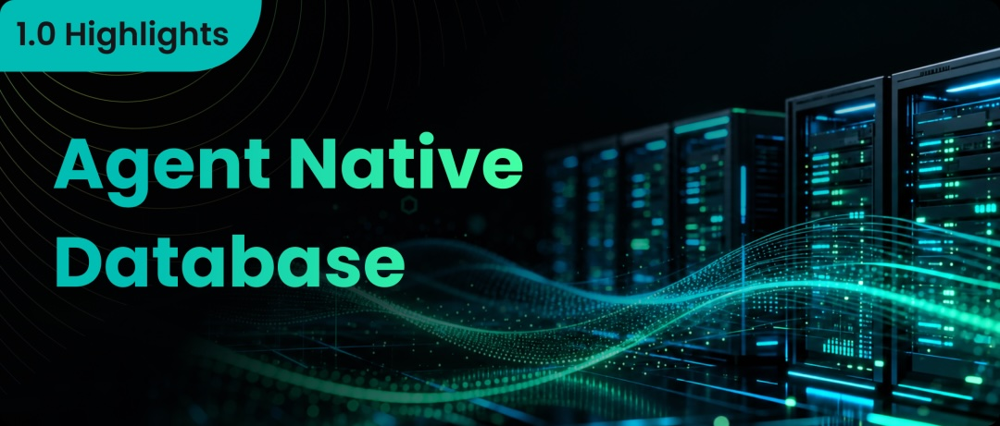
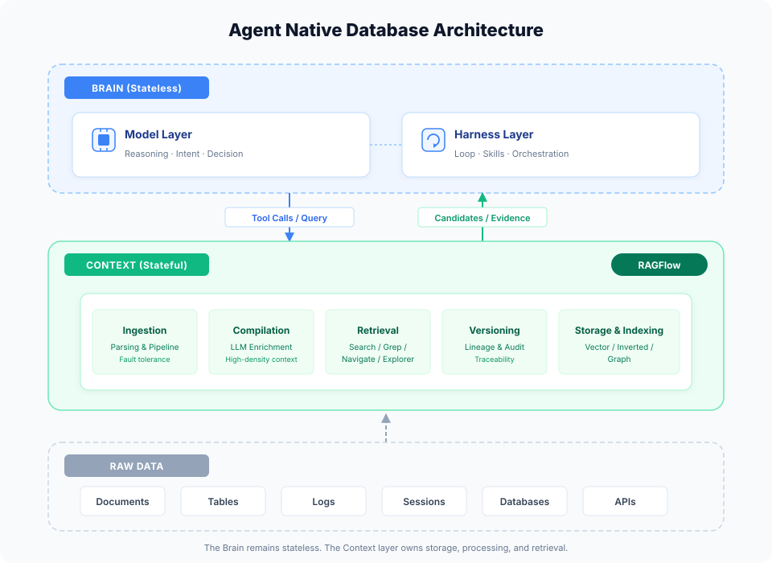
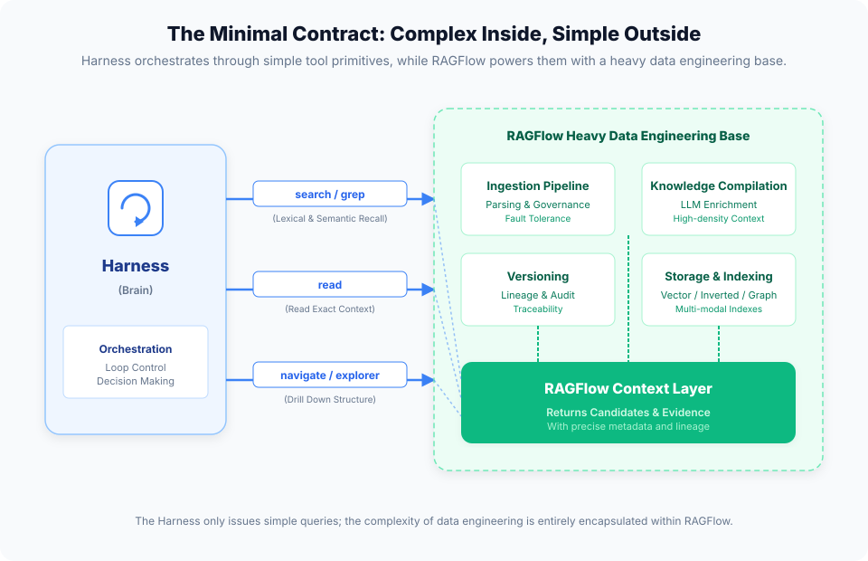

As large language models continue to expand in capability, AI application architectures are undergoing a profound restructuring.

In the past, we focused on how to “feed” external data to models. Now, as Agents become the main actors in applications, we need to ask: what kind of data foundation is required to support their long-running operation and continuous evolution?

That is the motivation behind RAGFlow 1.0’s new positioning: evolving from an end-to-end RAG engine into an Agent Native Database. Today, with the official release of RAGFlow 1.0, the Agent Native Database has moved from concept to implementation.

## I. Architectural Leap: Why Must the Context Layer Be Independent?

To understand the Agent Native Database, we first need to clarify the current evolution of the Agent ecosystem.

Over the past year, the components of the Agent Harness—task orchestration, context engineering, the Skills system, and memory operations—have been rapidly standardized and engineered. Meanwhile, the Managed Agents concept proposed by Anthropic earlier this year offers a highly instructive architectural abstraction: LLM and Harness are treated together as the “Brain”—a stateless decision core responsible for planning, reasoning, and dispatch. The actual capability boundary of an Agent is determined by the tools it can invoke.

This is a critical architectural dividing line: the Brain remains stateless and can be started or stopped at will, while all persistent state is stored externally. The entire ecosystem is thus moving toward a clear separation between the “state layer” and the “stateless layer.” If the Harness were made responsible for both reasoning and heavy data persistence, file parsing, and state rollback, the system would not only become extremely bloated but also scale poorly.

Based on this evolution, a three-layer understanding of Agent architecture has become consensus:
1. **Model layer**: responsible for understanding, reasoning, and decision-making.
2. **Harness layer**: responsible for loop control, task planning, Skills invocation, and read/write control of memory.
3. **Context layer**: responsible for storage, processing, and retrieval of persistent state.

RAGFlow’s positioning is to focus on the outermost Context layer. We are committed to processing data and supplying context so that the Harness above can operate with a light footprint.

## II. Why Can’t Existing Databases Simply Be “Extended”?

When building an Agent data foundation, the most natural approach in the industry is to extend existing databases (data lakes, data warehouses) by adding vector search and full-text search capabilities. This approach inherits directly from existing experience with big data platforms: it seems that installing a vector plugin is enough to form the prototype of an “all-purpose foundation.”

However, when we apply this approach to Agent scenarios, we quickly hit a wall:

**First, processing unstructured documents goes far beyond storage and retrieval.**
An Agent’s requirements for documents and other unstructured data are not limited to “can store it, can find it.” They involve a complete, complex pipeline for connecting to, governing, cleaning, and semantically enriching heterogeneous data sources. From complex PDF layout parsing and table structure reconstruction to using large models to extract entities, relations, and claims, and then building a navigation tree with evidence chains—this is fundamentally heavy data engineering, and it is difficult to accomplish elegantly as a black box inside a closed database kernel.

**Second, retrieval involves dynamic and deep requirements.**
When an Agent invokes retrieval, which indexing strategy should be used? Does the retrieval process require completion and navigation? Should the retrieved results return the full original text to the LLM, or only high-density fragments? This logic is highly complex and dynamic, cannot be expressed by traditional database query languages, and must be provided by a tool layer closer to the Agent.

**Third, structured data systems do not need to be rebuilt.**
Enterprises’ existing business systems already carry a large amount of structured assets; covering them again with a new database is neither realistic nor necessary. What the Agent really needs is an access interface to these systems, along with supporting documentation. As long as the foundation can provide feature-rich search over this “document-like metadata,” it is enough to help the Agent efficiently filter out tool options that do not match the current intent.

Taken together, an Agent’s data foundation absolutely cannot be just “a database with retrieval capabilities.” So what should it be?

The so-called Agent Native Database is not an existing database with a vector plugin bolted on. It is a highly complex context data control plane rebuilt around Retrieval, with large models as the processing engine and Agents as the retrieval consumers.

## III. Retrieval: A Data Control System Spanning Strategy and Engineering

Since it is a data control plane, what capability matters most in the Context layer? The answer is undoubtedly Retrieval.

But what supports Retrieval is far more than a simple search interface. RAGFlow’s ability to provide powerful retrieval services in the Agent era rests on two underlying infrastructures: the Ingestion Pipeline and the knowledge compilation system. Together they form Retrieval’s moat.

### 1. Ingestion Pipeline: An Enterprise-Grade Data Governance Foundation

Highly available retrieval must first be built on reliable data ingestion. The RAGFlow 1.0 Pipeline provides enterprise-grade governance mechanisms—the kind of “thickness” that many lightweight RAG solutions find hard to match:
- **Fault tolerance guarantees**: if any step is interrupted, the document is either complete or empty. Task-level redelivery, segment-level isolation, and idempotent overwrites ensure that data entering the retrieval system never leaves behind “dirty data” or a “half-written document.”
- **Versioning and metadata**: through dual-line version governance—“execution orchestration” and “knowledge provenance”—as well as strict channel isolation and lineage tracking, every piece of evidence retrieved can be traced to an exact version and original text, making the Agent’s data supply absolutely trustworthy.

### 2. Knowledge Compilation: A New Paradigm for LLM-Managed Data

On top of a reliable Pipeline, the knowledge compilation system not only reshapes the Token economy but also represents a new paradigm for reconstructing data management with LLMs. It is by no means merely for generating summaries; it is a customizable, extensible template engine:
- **Multi-form knowledge artifacts**: it currently covers tree navigation (providing hierarchical localization), graph exploration (providing entity-relation association), and LLM Wiki (providing synthesized reading), among other forms. Going forward, it will continue to expand with Ontology and Memory templates.
- **Constraining and guiding retrieval**: through compilation, knowledge is given a semantic skeleton. This allows the Harness, when retrieving, to avoid blind trial and error and instead know clearly “within what scope to search and what type of thing to look for.”
- **Extreme Token compression**: it transforms long text into high-density “claim–evidence pairs.” On a hit, a single query can save more than 90% of Tokens; on a miss, it adds only about 2% consumption. This lets the Agent go further within a limited window.

## IV. The Interface Between Context and Harness: Minimal Tool Primitives

Precisely because the underlying Pipeline and knowledge compilation system push “governance” and “compression” to the extreme, RAGFlow’s external interface can remain so restrained.

The core logic of infrastructure design is: the heavier the inside, the simpler the outside must be.

The Harness does not need to care about the complex parsing and index construction behind it; it only needs to interact through the most standard primitives:
- **search / grep**: lexical or semantic recall to probe for clues.
- **read**: read the original text or evidence by anchor to verify details.
- **navigate / explorer**: drill down in the navigation tree or graph to explore relationships.

On each call, RAGFlow returns only candidates and evidence, with precise citations and metadata. How to assemble these results into the Context Window and how to control the Token budget is entirely up to the Brain in the Harness. The Harness decides “what it wants”; RAGFlow is responsible for “giving it accurately and economically.” This clear contract allows any Agent to obtain the strongest retrieval capability at extremely low integration cost.

## V. Dual Form: Built-in Harness and Full Ecosystem Embrace

In actual product deployment, RAGFlow 1.0 plays both the role of “reference implementation” and “enabling platform.”

On the one hand, RAGFlow comes with a powerful built-in Harness.
Not every team has the resources to develop a complex Agent orchestration framework from scratch. RAGFlow includes a carefully tuned Harness that distills complex loop control into standard flows (such as evidence prefetching, the evidence gate, and the tool loop). Developers do not need to worry about how the underlying loop turns; they can get an out-of-the-box, high-speed experience directly through RAGFlow.

On the other hand, RAGFlow will fully embrace the external Harness ecosystem.
Many large enterprises already have their own orchestration layers, such as complex workflows built on LangGraph or fully self-developed Agent systems. RAGFlow will not force everyone to switch orchestration frameworks; instead, it is willing to serve as the “strongest add-on” for these external Harnesses.

To make external integration smoother, RAGFlow will focus on launching a complete CLI integration solution in the future. Regardless of the language in which your Harness is written, you can seamlessly access its powerful parsing, compilation, and retrieval tools by calling RAGFlow’s CLI or standardized API. It lets RAGFlow act like a local daemon, providing the highest-quality context for your Agent at any time.

## VI. Conclusion: From RAG Engine to the Cornerstone of Agents

Moving from an end-to-end RAG engine to an Agent Native Database, the evolution of RAGFlow 1.0 reflects a rethinking of the relationship between data and Agents.

As the Brain becomes stateless and the Harness becomes standardized, the Context layer—which carries all state and memory—becomes the key infrastructure determining whether Agents can truly move into production.

The Agent Native Database is the foundation born to meet this need. It takes on the mud of unstructured data and hands clean, high-density knowledge to the Agent.

Today, the release of RAGFlow 1.0 officially opens this architectural evolution. With a powerful built-in Harness and through APIs and the forthcoming CLI, it embraces all Harnesses. In an era of accelerating Agent explosion, only by making the context supply layer deep and thorough can Agents shed their immaturity and become productivity tools that enterprises can trust.

And RAGFlow stands at the starting point of this new track.