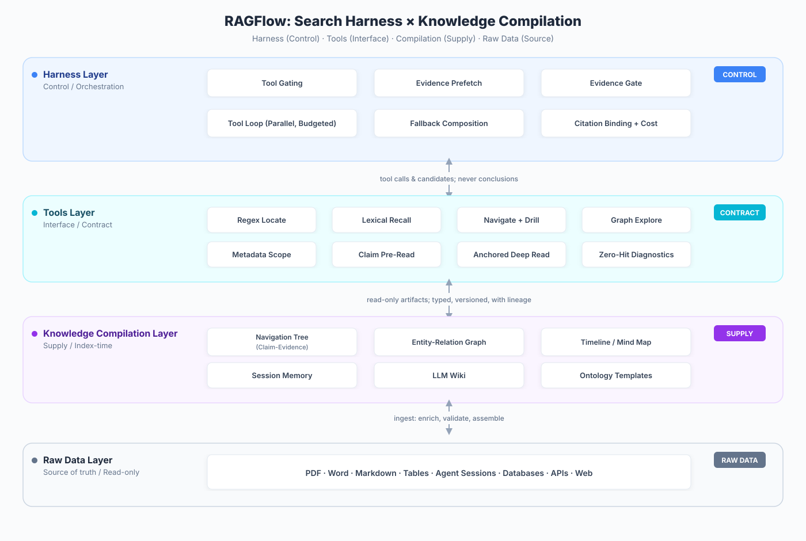

## I. The RAG Crossroads

Retrieval-augmented generation (RAG) has become the de facto standard for grounding large language models in enterprise knowledge over the past two years. By combining external knowledge retrieval with generative models, RAG significantly improves the timeliness and accuracy of generated content while substantially reducing hallucination rates. The logic sounds impeccable: when the model doesn't know something, look it up; once found, answer.

But reality is far more complicated than logic.

As enterprises move RAG from prototypes into production, a frustrating consensus is forming: **RAG is good, but nowhere near good enough.** Naive RAG—the standard pipeline of "chunk documents, embed them, compute similarity"—fails repeatedly in real-world scenarios. How should you define chunking strategy? Which embedding model should you use? What similarity threshold should you set? Every step demands extensive tuning, and even after tuning, retrieval quality remains unpredictable. Retrieved chunks are often irrelevant to the answer, and distractor passages mixed into context disrupt the LLM's reasoning process.

This led to advanced RAG: RAGFlow's DeepDoc for PDF parsing, sophisticated chunkers, hybrid search, GraphRAG's knowledge graph augmentation, RAPTOR's recursive summary trees, Contextual Retrieval's context-aware chunking. The stack grows more complex, the architecture diagrams look increasingly impressive—but the improvement in results has not matched the increase in complexity. **Complexity does not buy effectiveness.**

In 2026, two key events elevated this discussion to a new level.

**The first event: Andrej Karpathy's "LLM Wiki" concept.** He argued that raw notes should be treated as source material, compiled by an LLM into a continuously updated, explicitly cited, verbatim-readable Wiki—"knowledge compiled once and kept current, rather than re-derived on every query." This idea quickly spilled over from personal knowledge management into enterprise RAG, triggering widespread questioning of the traditional RAG paradigm.

**The second event: PwC US's provocatively titled research report, "Is Grep All You Need?"** **[2]** Researchers equipped an agent with both vector search and Grep, and found that Grep (exact string matching) often delivered higher accuracy than semantic search. Further comparison showed that Agentic RAG implemented purely with string matching was already approaching the quality of an LLM-Compiled Wiki **[3]**.

Both events point to the same conclusion: the traditional RAG paradigm of "query → match → rank" is being disrupted. The core of retrieval is shifting from "designing a stronger recall algorithm" to "designing a decision framework that dynamically orchestrates across multiple tools" **[1]** **[5]**. **Search is no longer an engine; it is a Harness.**

But Harness + Grep, while constituting an extremely strong baseline, is not the endpoint. As data scales, relying entirely on the Harness's iterative exploration and Grep's exact matching forces the agent to search repeatedly to locate the answer region—high token consumption, slow response times, and every new context window must re-experience the exploration process from scratch.

This is where knowledge compilation enters. The core thesis of this article is: **the Search Harness is the engine of Agentic Search; knowledge compilation is its context supply layer.** Knowledge compilation does not replace Search/Grep—it provides the Harness with richer, more compressed, more traceable knowledge artifacts, enabling the agent to locate answers with fewer iterations and lower token consumption.

---

## II. The Four Predicaments of RAG

To understand the value of knowledge compilation, we must first see the real predicaments RAG faces today. These are not defects of any single product, but structural problems at the paradigm level.

### Predicament 1: Naive RAG—"Inaccurate Search" Is Inevitable

Naive RAG's essence is a single pathway: "query → embed → similarity ranking." For raw documents, similarity is almost the only entry point. But the problem is: **similarity does not equal relevance, and relevance does not equal correctness.**

For a precise date query (e.g., "What was Q3 2025 revenue?"), vector search only introduces noise—semantically similar but entirely irrelevant. For a fuzzy conceptual question (e.g., "What is the core idea of microservices architecture?"), Grep simply cannot find relevant passages—because no one writes the exact sentence you're querying in a document. Sometimes the answer isn't in any single chunk at all; you need to first locate a set of candidate documents, then read each one deeply.

A single pathway cannot cover diverse query types. This is a structural defect of naive RAG, not something tuning can fix.

### Predicament 2: Advanced RAG—"Complexity Does Not Buy Effectiveness"

Advanced RAG attempts to solve the above problems by introducing more complex architectures. GraphRAG augments retrieval with knowledge graphs; RAPTOR organizes documents with recursive summary trees; Contextual Retrieval uses context-aware chunking. Each has its own paper, its own benchmark, its own adherents.

But the problem is: **deployment and maintenance costs rise sharply, while effectiveness gains fall far short of expectations.** GraphRAG treats fragmented graph structures as the primary retrieval source; after consuming enormous tokens, it delivers no fundamental improvement—only marginal gains in some multi-hop QA scenarios. Worse, these complex solutions often make systems harder to explain, debug, and maintain.

A RAG system that requires an expert to tune is untenable in real enterprise production environments.

### Predicament 3: The Challenge of Agent Harness + Grep

PwC's research found that when an agent is equipped with both vector search and Grep, Grep often delivers higher accuracy than semantic search **[2]**. This finding was quickly simplified into a provocative conclusion: "Grep replaces RAG."

But comparison experiments with Vector RAG show that relying solely on Grep does not outperform RAG in all scenarios **[3]**. The more accurate conclusion is: **a well-designed Agent Harness, even equipped only with simple tools like Grep, can approach or even surpass complex RAG in many scenarios.** This fundamentally challenges the assumption that "RAG must rely on complex retrieval architectures."

However, Harness + Grep, while an extremely strong baseline, is not the endpoint. As data scales, relying entirely on the Harness's iterative exploration and Grep's exact matching forces the agent to search repeatedly to locate the answer region—iterations grow linearly, token consumption grows exponentially. This is precisely where knowledge compilation must step in.

### Predicament 4: RAG's "Cold Start" Problem—The Deepest Issue

This is the deepest problem, and the one Karpathy's "LLM Wiki" concept precisely targets.

Traditional RAG starts from zero on every query. The user asks a question, the system embeds it, retrieves similar chunks from the vector store, stuffs results into the prompt, the LLM generates an answer—then everything resets. The next query repeats the same process. No accumulation, no state, no continuously evolving cognitive foundation.

Every query is a "cold start." Every time, the system must re-understand what's in the knowledge base, how documents relate to each other, which sources are authoritative. Run the same task against the same data twice, and the agent may return different answers—with no record explaining where the difference came from.

Pinecone estimates that agents spend 85% of their computational effort on "rediscovery" loops rather than actual task completion **[7]**. This is not a bug in RAG; it is a paradigm flaw. Knowledge compilation is the systematic response: move part of the "understanding" work from query time to index time, so the Search Harness doesn't start from zero every time.

---

## III. The Rise of Grep and the Boundaries of the Harness

Chapter II revealed RAG's four predicaments, with the third being particularly thought-provoking: a simple Grep tool, under an agent's orchestration, can approach or even surpass complex RAG. This discovery overturns the industry's conventional wisdom that "retrieval must depend on semantic understanding," but it also raises new questions—where are the boundaries of Harness + Grep? This chapter analyzes why Grep works, what role the Harness plays, and how the limitations of this combination lead us toward knowledge compilation.

### 3.1 Why Can Grep Beat RAG?

The answer to "Is Grep All You Need?" is far more complex than it appears.

PwC researchers equipped an agent with both vector search and Grep, finding that Grep often delivered higher accuracy than semantic search **[2]**. This finding is easily simplified to "exact matching is enough"—but the real insight lies in the paper's final conclusion: retrieval is not simply about returning knowledge to the agent; what matters is the framework—it determines what can fill the context and what operations the agent must perform before utilizing that context.

In other words, **what makes Grep powerful is not the tool itself, but how the agent orchestrates it.**

This forces us to distinguish two fundamentally different types of problems:

- **Semantic discovery problems**: answers hidden at the conceptual level, requiring semantic understanding to find
- **Evidence localization problems**: answers existing in literal evidence—names, dates, file paths, function names, error strings

For coding agents, much of the work falls precisely into evidence localization: finding symbols, tracing call chains, checking diffs, reading failed test cases, locating exact lines of code. In these cases, an exact string matching tool is far more directly effective than semantic search.

Notably, agents use Grep completely differently from humans. OpenAI's analysis of GPT-5's search behavior on BrowseComp-Plus shows: 98% of sessions use quoted search (far higher than human users), and median query length exceeds the human 99th percentile. AI is more "precise" and "structured" in exact matching—it can construct complex queries with multiple constraints that humans would be unlikely to type. Grep itself hasn't changed, but its user has shifted from human to agent, and the usage pattern has undergone a qualitative transformation.

### 3.2 The Limits of Harness + Grep: Exploration Cost and Token Overhead

But Harness + Grep, while an extremely strong baseline, is not the endpoint. The reason:

As data scales, relying entirely on the Harness's iterative exploration and Grep's exact matching greatly increases the cost of repeated exploration. The agent must Grep repeatedly to locate the answer region, causing two serious consequences:

1. **Slow**: every Grep is an IO operation; linear growth in iterations causes response times to skyrocket
2. **High token consumption**: every iteration loads search results into context; the cumulative tokens across multiple rounds are enormous

Facing each new context window, Harness-centric Agentic retrieval wastes calls relearning what constitutes an effective search strategy—over and over again. This is both expensive and slow.

Thus a natural question emerges: **how can we preserve the Harness's orchestration capability while shortening its exploration path?**

### 3.3 A Richer Tool System: Lessons from Microsoft's AgenticRAG

Microsoft's design for enterprise AgenticRAG (also called Agentic Harness for Retrieval) points in a clear direction: equip the Harness with richer tools, not just Grep **[4]**.

Its core architecture equips a lightweight agent for enterprise internal data search, significantly outperforming single-pass retrieval through iterative search. Each iteration relies primarily on three tools:

| Tool | Function | Typical Scenario |
|---|---|---|
| SEARCH | Discover relevant documents across the knowledge base | First exploration, broad search, validating enterprise terminology |
| FIND | Locate specific information within a single document | Known target in document, need precise metric lookup |
| OPEN | Retrieve full content with window from a single document | Need to read complete context of a specific document region |

SEARCH handles recall; FIND and OPEN handle deep reading—this tool combination elevates search behavior into atomic operations the agent can orchestrate.

Microsoft reports significant improvements on BRIGHT, WixQA, and FinanceBench, with ablation studies showing the largest gain comes from "shifting from single-pass retrieval to Agentic tool use" **[4]**. This confirms a judgment: **the Harness should not have only one hammer called Grep.** The division of labor among SEARCH (broad recall), FIND (precise localization), and OPEN (deep reading) lets the agent operate at different levels—first narrow the scope with SEARCH, then pinpoint with FIND, finally retrieve full context with OPEN.

Further research shows that BM25 + Grep can make the Harness perform even better—BM25 is weak in single-pass retrieval but much stronger inside the Agent Loop. This means we don't need complex embedding models and vector databases; vocabulary-level retrieval tool combinations alone can provide sufficient retrieval capability for the Harness.

### 3.4 Retrieval Is the Harness: From Tools to Orchestration Framework

Based on the above analysis, we can draw a core conclusion: **Retrieval itself is a Harness problem.**

It's not just about "what tools to provide the agent," but encompasses the following design dimensions:

- How queries are encouraged or constrained
- How results should be presented
- Whether search returns contain sufficient context
- Whether the model can issue follow-up searches
- When the agent decides it has enough information to answer
- How the Harness routes and orchestrates across different tools

In other words, **search is no longer an engine; it is an orchestration framework.** A well-designed Retrieval Harness, even equipped only with "simple" tools like BM25 and Grep, can through iterative orchestration approach or even surpass complex RAG in many scenarios.

But as noted, we cannot stop here. As data scales further, even the best Harness orchestration faces challenges in iteration count and token consumption. This leads to the next chapter's theme: how the knowledge compilation layer can provide the Harness with "higher-quality" tools—enabling each tool call to cover higher-quality context, thereby reducing iterations and lowering token consumption.

---

## IV. Knowledge Compilation: Providing "High-Density Context" for the Harness

Chapter III discussed the value and limits of the Retrieval Harness: it lets simple tools (BM25, Grep) achieve remarkable results through orchestration, but still faces excessive exploration costs at scale.

Knowledge compilation offers an answer from a different angle: **move the work of knowledge compilation from query time to index time.**

"Not assembling a few similar fragments on every question, but compiling knowledge once and keeping it current, rather than re-deriving on every query."

This idea quickly spilled from personal knowledge management into enterprise RAG. Vector database pioneer Pinecone introduced the Context Compiler concept in its 2026 Nexus knowledge engine **[7]**—using built-in Skills (document processing, entity extraction, text chunking, and other basic "functions") to automatically perform knowledge compilation, transforming user data into structured Artifacts. Unlike traditional RAG, which indexes raw documents directly, the retrieval target here is no longer unprocessed text fragments but a collection of pre-compiled knowledge artifacts rich in semantics and entity relations.

Pinecone's internal benchmarks show a financial analysis task that originally consumed 2.8 million tokens was completed on Nexus with only 4,000 tokens—a 98% reduction **[7]**. While this data has not yet been widely validated in customer production environments, the direction is clear: **knowledge compilation delivers order-of-magnitude token efficiency gains.**

In RAGFlow's architecture, our definition of "knowledge compilation" goes beyond the single LLM Wiki model. Knowledge compilation encompasses a series of semantic enrichment operations on data—especially large-scale data. In the current implementation, knowledge compilation takes the form of tree-structured navigation (with evidence-chain leaf nodes), graph-based associative exploration, timeline tracking, and ontology templates. The evidence chain is not a separate layer but a compression unit attached to tree navigation leaf nodes; the ontology is not a separate engine but exists as a knowledge compilation template.

### 4.1 Tree Navigation: Chapter Trees and Evidence-Chain Leaf Nodes

Generate appropriate hierarchical headings for massive document collections, using headings to determine chunk granularity, thereby providing localization services for large-scale data navigation. Typical scenarios include:

- Single long documents: books, textbooks, product manuals, legal statutes
- Multi-document aggregation: FAQ libraries, policy document collections, categorized document repositories

Tree structures let the agent "expand layer by layer" like a file manager—from root to chapter to section to paragraph—until locating the leaf node containing the answer. This navigation approach is particularly effective when user intent is unclear.

But in engineering practice, we discovered an important fact: **simply organizing documents into tree structures does not bring significant benefits to Agentic Search.** This directly contradicts conclusions from many similar open-source projects—for example, that providing navigation based solely on document chapter structures or hierarchically clustered semantic structures yields better results. These traditional tree structures, in a well-designed Agent Harness, are not just ineffective but negative assets: the agent still relies primarily on Search and Grep. What truly makes tree navigation valuable is the evidence-chain leaf nodes.

RAGFlow's current implementation works exactly this way: evidence chains hang on tree navigation leaf nodes. Claims and Evidence are extracted from source text to form retrievable, traceable evidence units that can exist as leaf nodes of the tree compilation structure:

- **Tree structure organizes**: provides the navigation skeleton of chapters, sections, and paragraphs.
- **Evidence-chain leaf nodes compress**: when the agent navigates to a leaf node, it receives the evidence chain, not the entire raw passage.
- **Together, they form the most effective knowledge compilation implementation validated to date.**

The value of evidence-chain leaf nodes is clear:

**Massive token savings on hits, minimal loss on misses.** Evidence chains enter context through two paths. The first is via dedicated tools—drilling down the navigation tree to leaf nodes, graph exploration, metadata scope selection. The second is as direct context filler: before the Agent Harness reads the raw Chunk, it first reads the corresponding Claim/Evidence; if the evidence is judged consistent with the question, it answers directly from evidence without reading the Chunk. This second path moves the token compression point before Chunk reading—the most token-efficient path in this architecture.

Under a unified accounting, **when compilation artifacts hit, a single question can save over 90% of tokens; when they miss, the loss is only about 2%.** On the larger multi-hop FRAMES Benchmark, evidence-chain compilation averages 30–40% token savings. The enormous asymmetry between hits and misses is precisely the economic foundation for pre-compiling evidence chains: most questions yield extremely high returns on hits, while the few misses cost very little.

**Construction doesn't require a great model.** Evidence-chain extraction doesn't need a strong model—a small model suffices. This helps reduce indexing costs, making large-scale data compilation economically viable.

**Traceable and auditable.** Every Claim is bound to Evidence, with clear answer provenance—essential for enterprise audit scenarios.

**Does not replace Search/Grep.** Search/Grep still handles finding candidate regions; tree navigation and evidence-chain leaf nodes help the Harness "use context sparingly" after localization.

Thus, the value of tree navigation lies not in point recall but in organization and carriage. With evidence-chain leaf nodes loaded, token efficiency improves significantly.

### 4.2 Graph-Based Associative Exploration

A graph structure centered on custom entities, where entity association rules (graph edges) are also user-defined. Typical scenarios include:

- Technical documents with frequent cross-chapter references (e.g., "see Section 3.2")
- Complex textbooks requiring layered understanding
- Professional documents with extensive entity definitions and cross-references (legal, medical, engineering specifications)

This custom template differs from past GraphRAG approaches that treat fragmented graph structures as the primary retrieval source. The latter, after consuming enormous tokens, delivers no fundamental retrieval improvement—only marginal gains in some multi-hop QA scenarios. RAGFlow's new graph structure is more flexible in entity extraction and relation definition, and these graph structures can be fully associated with tree navigation structures, providing alternative coverage of the same content regions.

Graph structures represent the next step in knowledge compilation—from "document organization" to "relational reasoning." Sharing the same compilation artifacts with tree navigation, they let the same knowledge be navigated hierarchically or explored relationally—the direction of continuous expansion for the knowledge compilation system.

### 4.3 Timeline Tracking

Build timeline indexes for continuously updated document collections (project docs, meeting minutes, changelogs), enabling the agent to filter and locate information along the temporal dimension. Typical scenarios: "What changed in last month's product requirements document?" "When was this bug introduced?"

### 4.4 LLM Wiki as a Compilation Layer Component

The widely discussed LLM Wiki pattern is positioned in our architecture as an optional synthesis layer above graph structures—users choose whether to further synthesize new content based on graph structures.

Compared to various LLM Wiki implementations, RAGFlow's approach is better suited to enterprise needs—a true Enterprise Context Layer **[6]**:

- **Fully customizable workflow**: entity and graph structures at the extraction stage are customizable; the generation process is configurable across Entity → Concept → Claim stages; output formats are customizable with built-in templates that enterprises can extend.
- **Continuous compilation and version management**: enterprises can build their own domain templates around the Wiki, forming an internally shareable, continuously maintained knowledge system.
- **Wiki is a compilation layer component, not a replacement**: enterprises choose whether to generate a Wiki based on data volume and token budget. It is not the Harness's only entry point but one of the combination tools alongside raw data.

### 4.5 Template System: Customizable, Extensible Knowledge Compilation

Knowledge compilation is not a fixed set of built-in capabilities but a customizable, extensible template system.

Compilation is template-driven. Templates specify what to extract, which fields to output, field types, constraints, presentation formats, and example prompts for synthesis. Built-in templates provide baselines covering tree navigation, graph exploration, timelines, LLM Wiki, and ontology. User templates let enterprises customize by domain without modifying engine code.

The template system's extensibility manifests at three levels. First, **compilation forms are extensible**: adding a new compilation artifact requires only a new template, not a new engine branch. Second, **extraction rules are extensible**: the same document can be extracted with different templates for different granularities of propositions and different entity relation definitions. Third, **output formats are extensible**: narrative paragraphs, structured fields, verbatim quotations—presentation formats are determined by template configuration.

The Memory template is a typical example. Session data differs from enterprise documents—it's organized by session_id rather than chapters. A new Memory template can aggregate session data by session_id, extract facts and evidence, and generate compilation outputs isomorphic to document evidence chains—a true Memory option. When the Harness needs to recall historical sessions, it can read memory evidence just like document evidence—same tools, same citation numbering, same evidence gate. Such extensions are completed at the template level within the current knowledge compilation framework, without modifying the Harness or tool layer.

The ontology template is another example. Its positioning here is clear: **it is a knowledge compilation template providing a semantic skeleton for retrieval.** Business users configure ontology TBox (concepts, relations, properties, constraints), and knowledge compilation generates corresponding ABox assertions. ABox assertions, like evidence chains, carry verbatim evidence and lineage. They can be searched independently—assertions themselves as retrieval targets, supporting direct lookup of concepts, entities, relations; they can enhance search—the Harness identifies the ontology domain involved in a query during planning, using assertions to expand synonyms, hypernym/hyponym relations, and associated entities, improving recall coverage; and they can constrain search—limiting entity types, relation paths, property ranges, reducing irrelevant results entering context. Like tree, graph, and timeline structures, ontology does not replace Search/Grep but provides compiled-in prior knowledge, letting the Harness know "what scope to search in, what types of things to look for."

**Compilation capability extensions are measured in configuration units, not engine branches.** This is the precondition for knowledge compilation to evolve continuously and cover diverse enterprise data forms.

### 4.6 Knowledge Compilation and Harness Synergy

Recalling Chapter III's conclusion: the Retrieval Harness achieves powerful results with simple tools through orchestration, but iteration costs are too high at scale. Now it's clear how knowledge compilation fills this gap.

Knowledge compilation provides "high-density" tools for the Harness—not giving the Harness one more search, but letting each tool call obtain greater information density. One expansion of a tree navigation tool may cover what multiple Grep searches would; one jump of a graph exploration tool may achieve what multiple rounds of vector retrieval's relational reasoning would.

This dramatically shortens the agent's exploration path. **It does not replace the Harness—it arms it**—replacing blind search with compiled structure.

**Knowledge compilation frees the Harness from "starting from zero" on every new context window.** Compile once, benefit many times—this is the engineering realization of "context as infrastructure."

---

## V. The Retrieval Harness: Stateful Iterative Retrieval

Traditional RAG treats retrieval as a single function call: query once, get back some fragments, hand to the model. Multi-hop, multi-document questions break this path. Hence Agentic RAG—retrieval becomes a process: search, read, search again.

But "process" itself is not the answer. An undisciplined loop degenerates into blind exploration: rewriting the same keywords, rereading the same document, piling dozens of irrelevant evidence pieces into context, finally betting on the model's patience for an answer.

RAGFlow's Retrieval Harness is the discipline for this process. In this version, we made a subtraction: removing the multi-path router that split by latency, freshness, and query type, leaving only one loop—but redefining "who decides what."

### 5.1 Putting Decision Rights Back Where They Belong

A loop contains three types of decisions, fundamentally different in nature:

- **What the framework must guarantee**: fetch compiled evidence before each round begins; judge whether it's sufficient to answer; if not, discard rather than stuff into context; remove tools proven useless on this corpus; retry or degrade model calls under budget when unstable; assign citation numbers at the moment evidence is delivered.
- **What the model excels at**: what words to search with, which document to read first, whether a passage is relevant.
- **What the retrieval engine should do**: regex matching, ranking, filtering—executed precisely, not simulated by the model in natural language.

The conclusion: **do not pursue "letting the model freely choose tools"; pursue ensuring that evidence entering context is the minimal sufficient set for this moment.** The model only needs to answer "what am I still missing"; the framework guarantees it won't force an answer on wrong evidence because some type of evidence is absent.

### 5.2 The Real Journey of a Query

**Station 1: Confirm whether this corpus is worth querying structurally.** If the dataset has never undergone knowledge compilation, navigation and graph exploration tools simply won't appear before the model—not even tool descriptions. No compilation, no payment for capabilities it can't use.

**Station 2: Evidence first.** Before the model thinks about how to search, the framework performs one evidence recall across the entire corpus, directly retrieving compiled atomic propositions—each with verbatim citations to source text. This is a flat read, not document routing: navigation trees route questions with bias—a small tree sends every question to the same one or two documents, and prefetch degenerates into background noise.

**Station 3: Binary choice.** If evidence is sufficient (enough count, sufficient source diversity), one model call produces the answer directly—the entire round reads no raw text. If insufficient, the entire block is discarded—not written into the system prompt (which would be billed repeatedly on every model call in the loop), and no citation numbers assigned (the model never saw it). The default approach is "stuff whatever is retrieved into context first"—here we do the opposite: when evidence is insufficient, discard what was first obtained and let the loop continue with clean context. Only with uncontaminated context does the model have a chance to truly retrieve decisive facts.

**Station 4: Tool loop with tools.** Multiple retrieval actions in the same round execute in parallel; tool errors don't interrupt the round but become a result the model can understand—a badly written regex should not end the entire retrieval round. The loop has step limits and round time budgets, converging doubly.

**Station 5: Deterministic close.** When the loop ends abnormally (model only leaves narration, or times out), the framework has a fallback path: synthesize a real answer from the question and evidence already in hand. Asking a question should not yield "let me check again."

### 5.3 Tools as a Diagnostic Table for "Why Didn't We Find It"

Agentic retrieval tools on the market typically look similar: a vector search, a full-text search, maybe a web search. RAGFlow's orchestration differs—tools are divided by "why this round didn't find it":

- **Remember the wording, just wrong form** (spelling, derivation, singular/plural): regex localization—one regex scans the entire library at once.
- **Remember the meaning, but don't know how the corpus phrases it**: pure semantic recall—must truly "escape vocabulary"; if keywords remain in the query as filters, semantic search is self-limiting.
- **Only know the topic, not which document to read**: route along the compiled navigation tree to the document, then drill into that document's compiled structure, directly retrieving propositions with verbatim citations.
- **Relational questions** (who connects to whom, what's the relation between A and B): subgraph exploration along entity relations—see the entire document's entity-relation skeleton at once.
- **Just want to scope first** (which documents meet criteria): metadata selector returns only documents, not content; this "document scope" handle can be passed across all subsequent retrieval actions, letting tools combine rather than being a series of independent calls.

The most sophisticated part is how zero-hits are explained. Lexical search zero-hits don't mean the corpus lacks this thing—they mean "your phrasing isn't the corpus's phrasing"—two conclusions leading to completely opposite next steps. So at the moment results are returned, the tool directly tells the model the judgment and next step: try a different semantic description, or describe a different type of thing. Feedback is written at the moment evidence is returned, not in the system prompt waiting for the model to remember.

### 5.4 Deep Reading: "Locate First, Then Turn Pages" Like a Human

Retrieved snippets are for localization only, not for evidence—a truncated window may have cut off exactly the sentence containing the answer.

So real reading is designed as anchor-based: name which paragraphs to read from what was just seen; the system first retrieves the entire document's reading-order index, then precisely retrieves full text by name. Several paragraphs can be extended before and after; overlapping windows merge automatically; each time you're told how many paragraphs the document has, where you've read to, and how much remains—long documents can be read page by page like a human.

The boundary between snippets and full text is never ambiguous: any snippet that is truncated or doesn't hit the searched keyword is explicitly marked "this is just a window" and cannot be cited as evidence.

Before deep reading, the Harness first checks whether the document's Claim/Evidence already covers the question; if covered, it does not enter deep reading and answers directly from evidence. This is another landing point for evidence chains as "pre-Chunk filtering."

### 5.5 Citations Are Mechanical, Not Guessed

A deliverable answer must be traceable to the exact paragraph.

RAGFlow does not gamble on this. Evidence receives its number at the moment of delivery to the model; the same snippet always has the same number throughout the session; citation markers in the answer are ultimately resolved one by one back to real snippets. The model cannot cite content it hasn't read—numbers are assigned at serving time, not reverse-engineered from similarity afterward.

The approach of using prompt instructions to tell the model "don't fabricate citations" and then using vector similarity to reverse-engineer sentence sources is essentially still gambling on probability. Here, there is no gamble.

### 5.6 Evidence Gate: The Same Question, Through Every Round

At this point, the Harness's discipline can be summarized in one principle: **evidence entering context must be the minimal sufficient set for this moment.** And the Harness uses a Jev-class decision model to model the judgment. It doesn't rerank, doesn't solve "how to order"—it answers a more upstream question: **is this batch of evidence necessary to send to the large model right now?** If sufficient, pass through and produce the answer in one call; if not, block and let the loop continue searching. Its value lies not in "sending better" but in "deciding not to send"—reducing tokens before rendering, rather than stuffing into context and then compressing with summaries.

"Deciding not to send" has a symmetric counterpart: **deciding not to read.** Before deep reading, use Claim/Evidence to judge whether it's already sufficient to answer; if sufficient, don't read the Chunk. Together, the send and read decisions form the complete closed loop of token compression.

---

## VI. Implementation Architecture

### 6.1 Overall System Architecture

The synergy between RAGFlow's unified knowledge compilation layer and Retrieval Harness is illustrated below:

This diagram corresponds to the article's main thread: **the Harness layer is the engine, the compilation layer is the supply layer, and the tool layer is the interface between them.** The evidence gate sits in the Harness layer, judging candidates from tool-layer returns and structures from the compilation layer.

### 6.2 Compilation Layer: Compiling Documents into "Retrievable Knowledge"

Compilation is not summarizing documents—it translates the same source text into structures of several different dimensions: hierarchical navigation, entity relations, timelines, mind maps, page indexes, Wiki, and most critically, atomic propositions—one-sentence facts paired with verbatim citations that must be contiguous substrings of the source.

Three structures correspond to three ways of asking: those who know the topic take navigation; those who care about relations take the graph; those who need precise facts take propositions. Propositions can be directly cited because they carry evidence, not because they were compressed.

Compilation is template-driven: built-in templates provide baselines; users can customize what to extract, which fields to output, and which rules to follow for their domain. Every artifact carries lineage (which documents, which paragraphs), and when documents are deleted, related contributions are precisely removed; rebuilding is an idempotent full recomputation—better to recompute entirely than leave half-new, half-old structures. Ontology also resides in this layer as one template: configure TBox, compilation generates ABox assertions, which can be searched independently or used in the Harness to enhance and constrain Search/Grep.

### 6.3 Execution Layer: Precise and Non-Contaminating

Regex and ranking are pushed down to engine-internal execution, not retrieved into memory and filtered; deep reading's "read index" and "retrieve full text" share the same reading order—two-stage reads won't misalign.

Raw and derived content channels are strictly isolated: content retrieval for model reading always excludes compilation artifacts; compilation structures enter context only through compilation tools. Derived knowledge does not impersonate raw text, and raw text is not drowned by structure—this is the precondition for supply layer and Harness synergy.

### 6.4 Runtime: Recoverable, Attributable

A session is an event log; failed rounds are rolled back, not carried into the next round as "calls made, no results" debris. Cross-round persistence retains only each round's final answer, not the evidence-gathering trace—long conversation costs don't explode linearly with rounds.

Resilience is part of the design: rate limiting, overload, and network jitter retry with backoff; client errors fail fast; conversation-level failover chains; the fallback-composition model and retrieval model use separate instances, preventing one failure from swallowing the answer.

Context is auditable: every piece of evidence that actually enters the model is recorded (which words hit, whether truncated, how large the source text). Per-round costs are attributed by stage (evidence gathering, evidence direct answer, summarization). When the answer is wrong, we can distinguish "didn't find" from "found but didn't use"—these two problems require completely opposite fixes.

### 6.5 Evidence Gate Integration

The evidence gate sits between tool-result rendering and prompt assembly, without changing any tool's calling contract—tools always return candidates, not conclusions. Three mandatory checkpoints: sufficiency judgment at evidence recall, evidence admission in each loop round, evidence pruning before answer composition.

Integration is progressive: first shadow comparison (gate judgments recorded in parallel with existing thresholds, not affecting production results), then replace by checkpoint one at a time. The reason is not conservatism—the gate's value must be validated by "how many tokens saved, whether evidence that should have been sent was blocked," not by "whether the model thinks it's good."

The Harness's advancement lies not in a longer loop but in three things: **decision-right layering**—the framework guarantees what cannot be delegated; the model does only what it truly excels at; **minimal sufficient evidence set**—answer directly if possible, discard entirely if insufficient, rather than filling context with irrelevant evidence; **mechanical citation and cost**—numbers generated at evidence delivery, costs visible by stage, the evidence gate turning "whether to send" from an empirical threshold into a decidable, auditable, end-to-end decision.

### 6.6 Engineering Implementation and Product Positioning

The above knowledge compilation layer, tool layer, and Retrieval Harness have been released to developers with RAGFlow's first official 1.0 version.

RAGFlow 1.0 is completely rewritten in the statically compiled language Go, replacing the previous Python version. The rewrite brings not just performance improvements but more importantly stability and scalability: concurrent compilation in the compilation layer, parallel calls in the tool layer, and long-session state management in the Harness are more controllable under static typing and native concurrency models, with clearer resource usage and failure boundaries for long-running operations.

With the 1.0 release, RAGFlow's positioning has upgraded from an end-to-end RAG engine to an Agent Native Database. It is no longer just a retrieval backend that "feeds fragments to models" but a context supply layer that the Agent Harness can directly call: whether the Harness needs raw snippets, compiled evidence units, navigation structures, relational skeletons, or memory facts, it can obtain them from RAGFlow. **The Harness orchestrates, RAGFlow supplies**—the division repeatedly emphasized throughout this article.

---

## VII. Conclusion and Outlook

The main thread of this article can be summarized in one sentence: **the Search Harness finds; knowledge compilation saves.**

Following this thread, Chapter II revealed RAG's four predicaments; Chapter III analyzed why Grep is so powerful in the agent's hands, the Harness's core role as an orchestration framework, and the fundamental limits of this combination at scale; Chapter IV demonstrated how knowledge compilation systematically responds to these limits—through tree navigation (with evidence-chain leaf nodes), graph-based associative exploration, timeline tracking, LLM Wiki, ontology templates, Memory templates—providing "high-density" context supply for the Harness, with a template system supporting continuous expansion; Chapter V explained how the Retrieval Harness centers on Search/Grep with knowledge compilation as the supply layer; Chapter VI presented the implementation architecture and product landing.

Our core propositions are:

1. **The Search Harness is the engine of Agentic Search.** The core of retrieval is shifting from "designing a stronger recall algorithm" to "designing a decision framework that dynamically orchestrates across multiple tools."

2. **Knowledge compilation is the Harness's context supply layer.** Knowledge compilation encompasses tree navigation, graph exploration, timelines, LLM Wiki, ontology, Memory, and more—a customizable, extensible template system. The most effective validated form is the evidence chain—a flat structure usable as tree leaf nodes. When compilation artifacts hit, a single question saves over 90% of tokens; on misses, only about 2% is lost; on the FRAMES multi-hop dataset, evidence chains average over 30% token savings.

3. **Knowledge compilation does not replace Search/Grep.** The essence of Agentic Search remains strong Search/Grep + Harness. Knowledge compilation's value lies in compressing context, reducing tokens, and improving traceability.

Industry trends confirm this judgment. VentureBeat's May 2026 analysis noted: "The RAG-to-vector database pipeline is no longer sufficient; Agentic AI needs a different approach to integrating context" **[8]**. Pinecone CEO Ash Ashutosh put it more bluntly: "RAG was built for human users; Nexus is built for agent users—because their language is completely different, their expected responses are completely different, and the tasks assigned to agents are completely different from chatbots" **[7]**. These judgments point in the same direction: **context is no longer a one-time assembled Prompt fragment but infrastructure that must be compiled, maintained, and reused.**

Knowledge compilation is fundamentally changing how people and organizations use knowledge. From simple RAG to knowledge compilation, from "re-derive on every query" to "compile once, benefit many times"—this is not just technical architecture evolution but a redefinition of "context" itself: **context as infrastructure.**

As knowledge compilation and Agentic Retrieval mature together, building enterprise context layers will rapidly democratize: more and more enterprises will inject internal data into this layer, forming proprietary, evolvable business cognition systems. Along this direction, RAGFlow will continue expanding knowledge compilation input forms, deepening integration with external Harness frameworks, and continuously open-sourcing the knowledge compilation layer—making evidence chains, ontology templates, and Memory templates reusable engineering standards rather than proprietary architecture.

The concepts, architectures, and empirical measurements discussed in this article are detailed in our recent research paper, ***Context as Infrastructure: Knowledge Compilation for Retrieval in Agentic Systems with Harnesses*** **[9]**. We invite readers to explore the full experimental results and methodology there.

The RAG crossroads is not a crossroads of "whether to retrieve" but of "**how retrieval is orchestrated and how context is supplied.**" The Search Harness finds; knowledge compilation saves. Compile once, benefit many times—this is the starting point of context infrastructure in the Agentic era. And RAGFlow 1.0 is turning it into open-source reality: a Go-rewritten, extensible Agent Native Database.

---

**References**

**[1]** Agentic search - retrieval, harness, or model? https://softwaredoug.com/blog/2026/06/08/three-kinds-of-agentic-search
**[2]** Is Grep All You Need? How Agent Harnesses Reshape Agentic Search. arXiv:2605.15184
**[3]** Vector RAG vs LLM-Compiled Wiki: A Preregistered Comparison on a Small Multi-Domain Research. arXiv:2605.18490
**[4]** AgenticRAG: Agentic Retrieval for Enterprise Knowledge Bases. arXiv:2605.05538
**[5]** Rethinking Agentic RAG: Toward LLM-Driven Logical Retrieval Beyond Embeddings. arXiv:2605.27123v1
**[6]** The Enterprise Context Layer, Andy Chen. https://andychen32.substack.com/p/the-enterprise-context-layer
**[7]** Pinecone Nexus Knowledge Engine. https://www.pinecone.io/blog/introducing-nexus-knowledge-engine/
**[8]** The RAG era is ending for agentic AI — a new compilation-stage knowledge layer is what comes next. VentureBeat, 2026.
**[9]** Context as Infrastructure: Knowledge Compilation for Retrieval in Agentic Systems with Harnesses. arXiv:2610.41172. https://arxiv.org/abs/2610.41172
